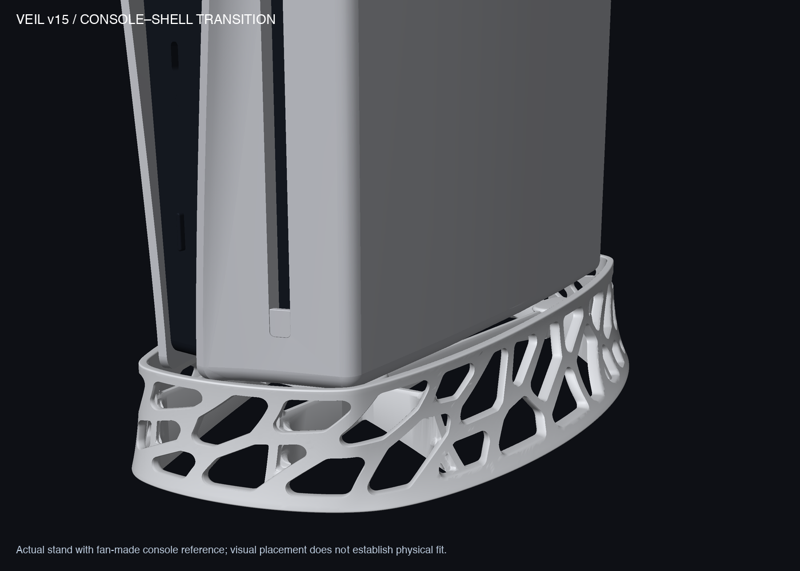
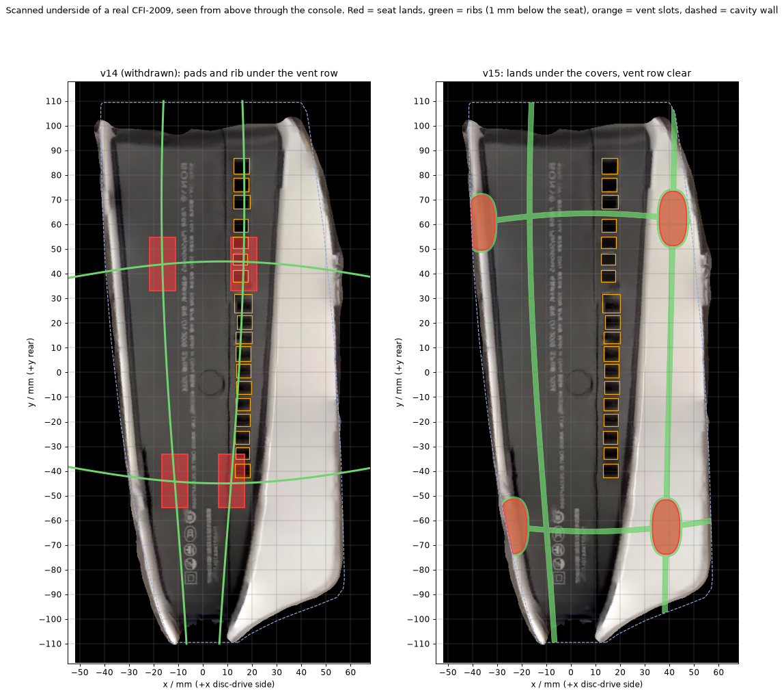
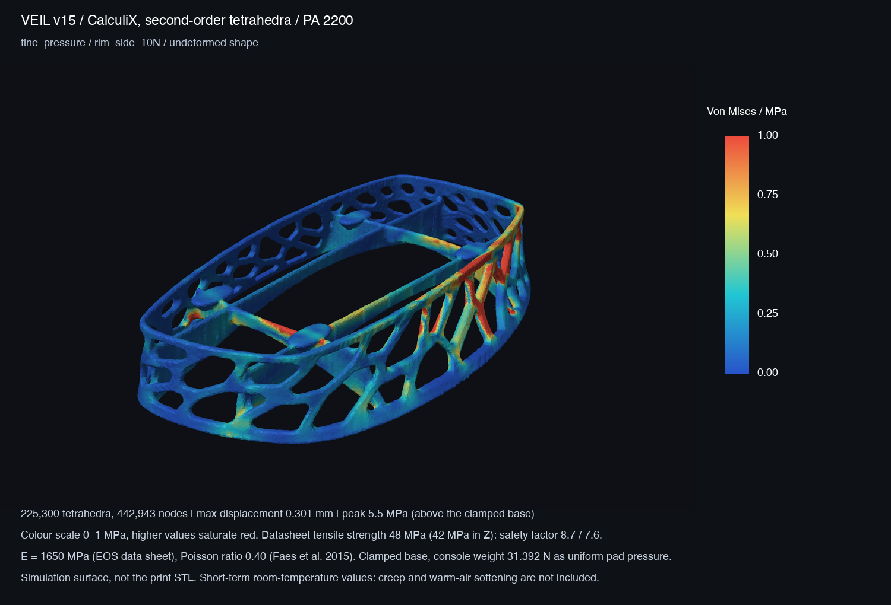
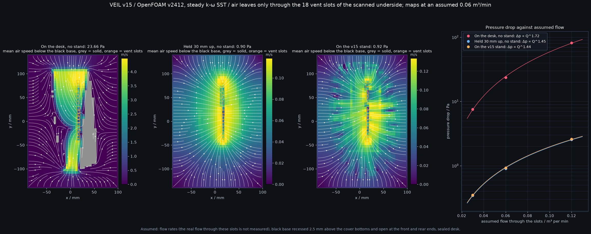

# Veil — a vertical stand for the PS5 Slim

A one-piece, 3D-printed stand that lifts a PS5 Slim (disc model, CFI-20xx) 30 mm off the desk inside a perforated, sculpted shell.

**Status: review prototype (v15).** The seat was redesigned on 2026-11-13 against a scan of a real console, and the stress and airflow tests were redone. Nothing has been printed, fitted to a console or heat-tested yet. The earlier v14 release was withdrawn: its seat pads sat under the console's vent slots.

[Standalone view](designs/v15/output/hero_v15.png) · [four views](designs/v15/output/preview_v15_clean.png) · [turntable](designs/v15/output/turntable_v15.png) · [full engineering report](designs/v15/README.md)

## Design philosophy

- **One continuous surface, not a frame.** The shell is a single sculpted wall with 72 irregular, rounded openings that drift around it in one flowing pattern. It should read as part of the console's own curves, in the spirit of Zaha Hadid's buildings, and not as a basket of struts.
- **Quiet silhouette.** The outline is strictly convex with no ripples, the rim is nearly level, and the base ring is flat. The interest is in the openings, not in the outline.
- **Structure stays out of sight.** Four ribs and four pads under the console carry the weight. From normal viewing angles only the shell is visible.
- **The console sits the way it sits on a desk.** On real hardware the two white covers end 2–3 mm below the black base, so the console stands on the cover bottoms. The four pads sit under those covers. Nothing touches the black base.
- **Nothing under the vents.** The black base has a row of 18 vent slots. No pad and no lengthwise rib is beneath it.
- **Measured, not assumed.** The seat is laid out on a scan of a real CFI-2009, scaled to the console's published size.
- **Loose, forgiving fit.** 1.5 mm clearance all round the console, checked with a cheap flat gauge before the full print.
- **Air first.** No floor, no closed panels. The console is lifted 30 mm, and the wall openings (about 112 cm²) are far larger than the vent slots they feed (about 6 cm²).
- **Compact footprint.** 153 × 247 mm on the desk, for a cavity of about 99 × 219 mm.
- **Made by a print service.** Shaped for laser sintering in one piece with no supports.
- **Say what is known.** Every number here is labelled as simulation, data sheet or assumption. Nothing is called validated until a part has been printed and tested.

## Specifications

| | |
|---|---|
| Fits | PS5 Slim, disc model (CFI-20xx), standing vertically. Outer shape from a fan-made 3D model; underside from a phone scan of one CFI-2009 |
| Overall size | 152.83 × 247.08 × 40.70 mm |
| Volume / mass | 78.14 cm³; about 73 g in sintered PA12 (0.93 g/cm³) |
| Console lift | 30 mm from desk to the bottoms of the console's covers |
| Cavity | About 99 × 219 mm outline, 1.5 mm nominal clearance to the console all round |
| Rim height | 38.0 to 40.7 mm above the desk (8 to 11 mm above the cover bottoms) |
| Wall | 2.8 mm at the two tight ends, rising to 3.5 mm along the long sides (80% of the perimeter is above 3.3 mm); thickened inward only |
| Wall shape | Strictly convex in plan; tightest rim radius 10.7 mm; leans at most 43.6° from vertical |
| Openings | 72, with rounded corners, about 112 cm² in total |
| Seat | Four flat pads in one plane, each a 21.6 × 10.6 mm land (206 mm²). Two under the disc-drive cover at (41.4, 62.4) and (38.6, −62.7) mm; two under the rim of the other cover at (−36.5, 60.6) and (−23.5, −62.5) mm |
| Support polygon | 78 mm wide at the rear, 62 mm at the front, 125 mm long |
| Ribs | Four, 2.8 mm thick, crest 1 mm below the seat so only the pads touch the console; none runs along the vent row; crossings and wall junctions filleted |
| Base | Flat open ring; no floor |
| Material and process | White PA12 nylon, laser sintered (SLS), bead-blasted. HP Multi Jet Fusion PA12 if black is wanted |
| Reference material data | EOS PA 2200: modulus 1,650 MPa, tensile strength 48 MPa in the build plane and 42 MPa along the build direction, heat deflection 64 °C at 1.80 MPa |
| Files | 3MF and STL of the stand, a flat cavity gauge (106.91 × 227 × 1.6 mm) and a local print coupon (58 × 36 × 40.7 mm) |

## The real underside

The picture shows the underside of a real CFI-2009, seen from above through the console, with the old seat on the left and the new one on the right.

- The fan-made model used up to v14 has a flat, symmetric black base with no openings, and covers that end above it.
- The real console has covers that end **below** the black base, a row of **18 vent slots** on the disc-drive side, and a wedge-shaped black base.
- The scan is scaled to the published depth of 216 mm (the disc model is listed at 358 × 96 × 216 mm and 3.2 kg) and fitted to the model's outer shape to 1.6 mm RMS. Positions in plan are good to about 2–3 mm.
- **The step between covers and black base is 2–3 mm in the scan, and that number is rough.** The scan is too coarse to measure it properly.

Details: [engineering report, sections 1 to 3](designs/v15/README.md).

## Stress test (simulation)

Method: Gmsh meshes with second-order tetrahedra, solved with CalculiX 2.20 as linear elastic PA 2200, base clamped, on three mesh densities (106,000 to 306,000 elements). The console is 3.2 kg (31.4 N). It is applied either as an even pressure on the parts of the pads under the covers, or as a rigid flat plate resting on the pads.

| Load case | Deflection | Highest stress | Safety factor (build plane / build direction) |
|---|---:|---:|---:|
| Console weight | 0.05 to 0.12 mm | 3.0 MPa | 16 / 14 |
| Weight shifted to the disc side | 0.06 to 0.17 mm | 3.9 MPa | 12 / 11 |
| Weight plus a 10 N sideways push on the rim | 0.30 mm | 6.5 MPa | 7.3 / 6.4 |

- Deflection ranges cover the two ways of applying the load; stresses are the higher of the two finer meshes.
- 99.9% of the material stays at or below 2 MPa in every case.
- The four pads carry 20%, 30%, 26% and 24% of the weight. All four stay loaded in every case.
- The weight cases are lower than v14's (4.7 and 6.1 MPa) because the pads now stand next to the wall.
- Two peaks are not final numbers because they change with the mesh: the wall strut under the side push (5.5 to 6.5 MPa) and the edge of a pad in contact (2.9 to 3.7 MPa).
- Safety factors compare with short-term, room-temperature data-sheet strength. Slow sag under constant weight (creep), softening in warm air, tipping and sliding are not modelled.

Details: [engineering report, section 4](designs/v15/README.md).

## Wind test (airflow simulation)

There is no physical wind-tunnel test. An OpenFOAM v2412 model (steady flow, k-ω SST turbulence model) asks one question: how hard is it for air to reach the 18 vent slots under the console?

Three arrangements are compared: the console standing straight on the desk, the console lifted 30 mm with nothing under it, and the console on the stand. Air leaves only through the scanned slots. **The flow rates are assumptions**; the flow the console really draws through these slots has not been measured.

| Assumed flow | On the desk | Lifted 30 mm, no stand | On the stand | Stand adds |
|---:|---:|---:|---:|---:|
| 0.03 m³/min | 7.6 Pa | 0.34 Pa | 0.35 Pa | 0.006 Pa (1.6%) |
| 0.06 m³/min | 23.7 Pa | 0.90 Pa | 0.92 Pa | 0.024 Pa (2.6%) |
| 0.12 m³/min | 82.0 Pa | 2.56 Pa | 2.59 Pa | 0.031 Pa (1.2%) |

- **The stand adds 1 to 3% to the pressure drop.** Almost all of the drop is the slots themselves, which no stand can change.
- **Standing straight on the desk costs 22 to 32 times more**, because the air must squeeze through the thin gap under the black base. That figure depends strongly on the gap height: 39 Pa with a 2.0 mm gap, 12 Pa with 3.5 mm, at the middle flow.
- Refining the mesh changes the stand result by −12%, and the lifted result by the same amount, so the comparison holds.
- This is not a cooling prediction. The console has other, larger air inlets that are not modelled, and the model has no heat in it.

Details: [engineering report, section 5](designs/v15/README.md).

## Notice for printing

Full brief for the print service, in English and Chinese: [designs/v15/PRINT_SERVICE.md](designs/v15/PRINT_SERVICE.md).

1. **Check your own console first.** Stand it on a flat table. It should rest on the bottoms of the two white covers without rocking, with the black base clear of the table. If it does not, this stand does not fit it.
2. **Fit check next.** Print only the flat gauge and the small coupon at home in PETG. Lay the gauge around the console's base to check the outline; use the coupon to judge the openings, a rib and a pad at full size. Neither can carry the console.
3. **Then the stand**, in white SLS PA12, bead-blasted, in one piece, flat with the base down.
4. **Scale:** millimetres, 100%. Do not scale the part to fit a build volume; the cavity must stay true to size.
5. **Do not let the service alter it:** no filled or closed openings, no added floor, no thickened walls, no vapour smoothing or coating. The openings are the air path.
6. **Keep as printed:** the four flat pad tops, the flat base ring and the inner cavity outline. The four pad tops must lie in one plane; ask for their expected flatness.
7. **Ask which PA12 powder and machine they use.** The strength figures above are for EOS PA 2200 and another powder may differ.
8. **Do not print the whole stand in PETG or PLA and trust these margins.** PETG's strength is 29% lower in the plane and 45% lower between layers, and it softens far earlier (heat deflection 69 °C against 157 °C at 0.45 MPa).
9. **Before the console goes on it:** check that it rests on the four pads by its white covers, that the row of vent slots is not covered, that cables and the disc slot are clear, and that the stand does not rock.

## Still open

- **Step between covers and black base.** The scan says 2–3 mm. A ruler reading at the front and rear of each cover is needed.
- **One console was scanned.** Other CFI-20xx revisions are not checked.
- **Rear grille.** Teardown photographs show a grille low on the back of the Slim. The rim stands 8 to 11 mm above the cover bottoms; whether it overlaps that grille on real hardware has not been checked.
- **Fan flow** through the underside slots is unmeasured.
- No slicing, printing, fit, load, creep or thermal test has been done.

## Repository

| Path | Contents |
|---|---|
| [designs/v15/](designs/v15/README.md) | The design: generator source, exports, renders, stress and airflow studies, print brief |
| [references/console-scan/](references/console-scan/underside.json) | The real underside measured from a phone scan: cover edges, vent slots, height map |
| `references/console-model/` | The fan-made console model, used for the outer shape |
| `designs/v15/baseline_v13/` | A few v13 files that the review scripts compare against |
| `src/` | The mesh renderer used for the pictures |
| `docs/` | Project history and notes |

Only v15 is kept on this branch. Earlier versions (v5 to v14) remain available at their Git tags, listed in [docs/VERSION_HISTORY.md](docs/VERSION_HISTORY.md).

Console reference model: [PS5 Slim by rtql8d on Sketchfab](https://sketchfab.com/3d-models/ps5-slim-a48efc06663541a1bc19297995fea91d).
