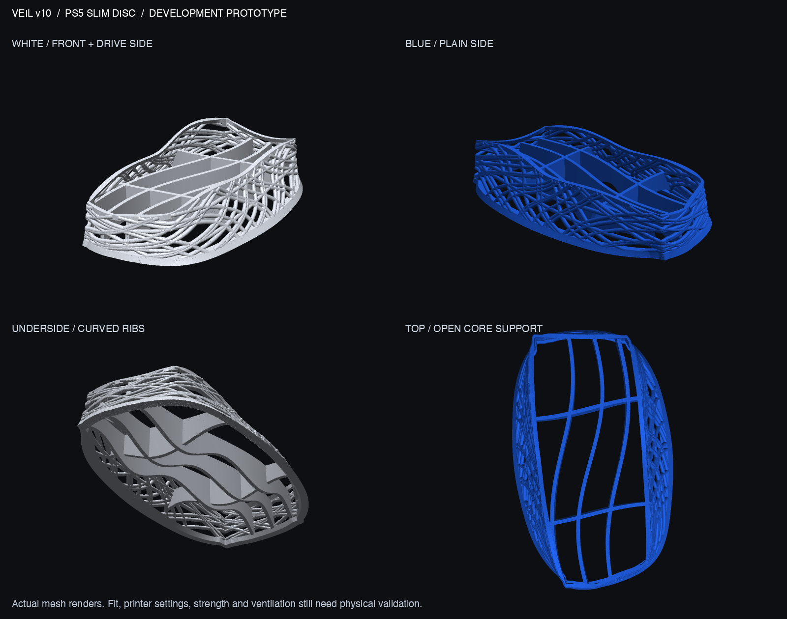

# Veil v10 — dense flowing nest

**Aesthetic review candidate; not yet user-approved or qualified for console use.** A dense weave follows the lower console silhouette, using one rounded strand profile throughout. Three curved supporting rails and two transverse ties replace the star-and-hub underside.



[See the reference assembly](output/reference_assembly.png). This uses the supplied fan-made console model and establishes visual placement only, not physical fit.

The mesh measures **151.32 × 244.47 × 53.22 mm**, with a geometric volume of **131.40 cm³**. Two long contour strands and 66 rising strands use a nominal **3.3 mm round section**. The seat remains 30 mm above the desk; nominal reference clearance remains 1.5 mm. The earlier symbol-shaped wire sections and star underside are superseded.

## Deliverables

| File | Purpose |
|---|---|
| [3MF](output/veil_v10_prototype.3mf) / [STL](output/veil_v10_prototype.stl) | Complete prototype; millimeters, no printer settings |
| [Editable source](source/veil_v10.py) | Parametric geometry generator |
| [Fit gauge](output/GAUGE_v10_cavity_1.6mm.stl) | Outline check only; not load-bearing |
| [Print coupon](output/PRINT_TEST_v10_section.stl) | Tie/web-junction section, about 58 × 36 × 48.14 mm, 9.74 cm³; not a strength specimen |
| [Geometry checks](output/validation.json) | Mesh, reference-envelope and layer-screen results |
| [Vendor brief](PRINT_SERVICE.md) | English/Chinese process-review instructions |

`undercroft_sleek.stl` is a component reference, not the complete stand to order. STL/3MF and test pieces reopen successfully. The main STL is one connected watertight mesh with consistent winding and 177,768 triangles.

## What remains unresolved

**No FEA has been run for v10.** [v7's stress results](../v7/STRUCTURAL_ANALYSIS.md) are historical and do not validate this changed weave or support structure. No physical fit, print, strength, creep or thermal testing has been performed.

The extruded inherited console-plan intersection is 0 mm³. The nominal clearance envelope has a 0.5073 mm³ intersection after export, so 1.5 mm is a design target rather than a certified minimum everywhere. The reference black-core section overlaps the supports by about 1,055 mm²; actual contact location and pressure still require hardware checks.

A geometric screen at 0.2 mm intervals flags two nonoverlapping-island events and substantial local overhang: the largest area outside the preceding layer's 45° growth envelope is **191.65 mm² at z=14.1 mm**. The curved rail arches are a major FDM review area. This is not a slicer; fewer islands do not establish support-free printing. A provider must assess orientation, supports and removal, or a suitable powder-bed process, before manufacture.

Conditional rigid-body tipping estimates span about 4.86–6.04 N for a top push at 388 mm, assuming a 3.2 kg console, assumed center-of-mass positions, rigid no-slip coupling and a flat desk. The loose cavity does not enforce that coupling. These are not stability or strength qualifications.

Vent locations, plugs, cable bends and disc clearance need direct checks. [Sony ventilation evidence and limits](../v6/VALIDATION.md#ventilation-evidence-and-limits) still apply; the precise bottom intake/exhaust question remains unresolved. No airflow or cooling benefit is claimed.

## Reproduce

From the project root using Python 3.13 and the project's `.venv-cad` environment:

```sh
VEIL_SUPPORT=sleek VEIL_REINFORCE=0 .venv-cad/bin/python designs/v10/source/veil_v10.py designs/v10/output
.venv-cad/bin/python designs/v10/source/validate.py
.venv-cad/bin/python designs/v10/source/render_preview.py
.venv-cad/bin/python designs/v10/source/render_context.py
```

These are the current source defaults. Do not enable the inherited v7 reinforcement trial and assume it is appropriate to v10. Editable geometry is Python; no STEP/B-rep file is claimed. Preserve historical designs and original uploads when iterating.
