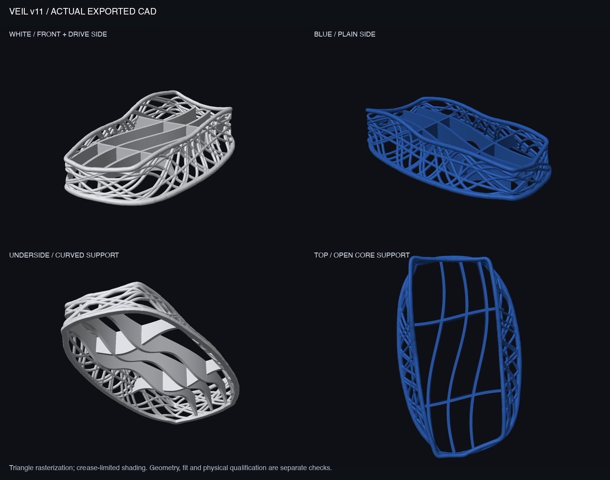

# Veil v11 — continuous guides and blended connections

v11 refines the dense round-strand nest with periodic spline guides, eased strand endpoints, rounded top/base rings and dedicated local blends at ring roots and middle-web crossings. The exterior follows the lower console silhouette; three curved rails and two ties form the underside.

**Historical geometry candidate; the user requested an aesthetic redesign as v12. Not a qualified console support. No v11 FEA or physical fit, print, strength or thermal testing has been completed.** Historical v7 stress fields do not validate this geometry.



[Reference console assembly](output/reference_assembly_clean.png) · [Flat-shaded junction comparison](output/junction_comparison_flat.png) · [Ring-root blending](output/junction_blend_process_flat.png) · [Crossing blending](output/crossing_blend_process_flat.png)

## Delivered geometry

The final mesh measures **151.71 × 244.56 × 53.22 mm**, with a geometric volume of **128.41 cm³**. The 30 mm seat and 1.5 mm nominal reference clearance remain. Midspan strands are 3.3 mm diameter and enlarge toward the rings; the top ring is 4.8 mm diameter, while the desk-clipped base ring has a 6 mm round source profile and a 5 mm vertical span.

| File | Purpose |
|---|---|
| [3MF](output/veil_v11_prototype.3mf) | Complete development mesh; millimeters, no printer settings |
| [Compressed STL](output/veil_v11_prototype.stl.gz) | Lossless gzip of the same raw STL; decompress before importing |
| [Fit gauge](output/GAUGE_v11_cavity_1.6mm.stl) | About 106.91 × 227 × 1.6 mm; outline check, not load-bearing |
| [Local process coupon](output/PRINT_TEST_v11_section.stl) | 58 × 36 × 48.17 mm, 9.47 cm³; tie/web region, not a strength specimen |
| [Geometry method](GEOMETRY_METHOD.md) | Equations, root/crossing construction and continuity limits |
| [Geometry checks](output/validation.json) | Mesh, envelope and layer results |
| [Vendor brief](PRINT_SERVICE.md) | English/Chinese prototype-process review |
| [Editable source](source/veil_v11.py) | Parametric geometry; see reproduction steps below |

The raw STL is approximately 110 MB and remains local; Git carries its gzip form and the 3MF. Large preblend/root-only/guide-array caches are local and regenerated by the source. They are not manufacturing alternatives.

## What the checks establish

The final main mesh has **2,205,760 triangles**, is watertight with consistent winding, and is one connected body. STL/3MF dimensions and volume agree. Export precision cleanup was independently reviewed; see [the method](GEOMETRY_METHOD.md#export-topology-repair). It welded microscopic slivers without generic hole filling, followed by a 0.004 mm simplification for the delivered body.

The inherited extruded console-plan intersection is 0 mm³. The nominal-clearance envelope has a measured 0.0000126 mm³ intersection after export; this does not establish an exact 1.5 mm minimum clearance everywhere or fit to real hardware. The reference black-core section overlaps the rails by about 1,055 mm², which is a geometric overlap rather than a verified contact patch.

The 0.2 mm layer screen flags two nonoverlapping-island events and **184.65 mm² outside the preceding layer's 45° growth envelope at z=14.1 mm**. The broad rail arches remain a significant FDM support concern. This is not a slicer or evidence of support-free printing. Conditional rigid-body tipping estimates span about 4.83–6.00 N under assumed mass, center of mass, rigid no-slip coupling and desk contact; a loose cavity does not enforce those assumptions.

**C2 guide curves do not guarantee global G1/G2 continuity of the triangulated Boolean surface.** The model includes 132 root patches and 305 selected crossing patches, sampled locally rather than globally remeshed. Small patch-boundary bands remain visible in flat-shaded close-ups. Overview renders use restrained normal interpolation for presentation; the close-ups retain flat face normals. Neither changes the manufacturing geometry.

Hardware fit, core contact, plugs/cables, disc access and all vents need direct inspection. [Sony ventilation evidence and its limits](../v6/VALIDATION.md#ventilation-evidence-and-limits) still apply. The exact bottom intake/exhaust region remains unresolved; no airflow or cooling benefit is claimed.

## Reproduce and inspect

From the project root with Python 3.13 and the project's `.venv-cad` environment, first install `source/requirements.txt` if needed. Geometry creation has two stages:

```sh
.venv-cad/bin/python designs/v11/source/veil_v11.py designs/v11/output
.venv-cad/bin/python designs/v11/source/blend_crossings.py
.venv-cad/bin/python designs/v11/source/validate.py
.venv-cad/bin/python designs/v11/source/render_clean.py
```

The first stage writes the root-only model, gauge and guide caches. The second writes the complete crossing-blended body and the relevant coupon. Do not distribute first-stage manufacturing filenames as final while the second stage is still running. The delivered build used the independently repaired full-precision crossing cache via `recover_crossing_export.py`; its provenance is documented in [the method](GEOMETRY_METHOD.md). The standard build now includes bounded repair and automatic fine-cache recovery when needed. That integration was syntax-checked and audited after delivery, but not rerun end to end; the completed run used the independently reviewed recovery path. Caches are not included in Git, and exact byte identity across library versions is not promised.

To inspect the delivered mesh without regenerating geometry:

```sh
gzip -dk designs/v11/output/veil_v11_prototype.stl.gz
.venv-cad/bin/python designs/v11/source/validate.py
.venv-cad/bin/python designs/v11/source/render_clean.py
```

Skip decompression if the raw STL already exists. The render scripts use repository helpers in `src/`; preserve the repository layout. Editable geometry is Python, not a STEP/B-rep file. v10 and original imports remain preserved.
