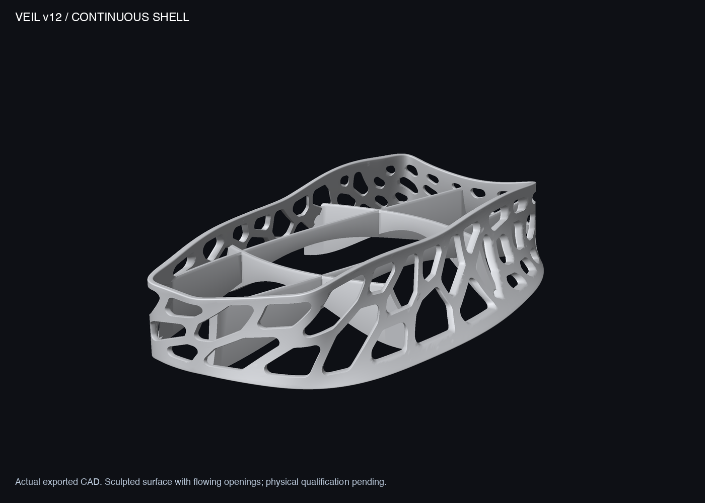

# Veil v12 — sculpted shell with flowing openings

A continuous sculpted surface with 72 irregular rounded openings, a restrained silhouette and a lower internal support web. The openings follow a shared flow around the console; the visible web is the shell itself.

**Visual prototype awaiting user review, not a qualified console support.** No FEA has been run for v12. Historical v7 stress results do not apply to this design.



[Console–shell transition](output/assembly_base_detail.png) · [Full reference assembly](output/reference_assembly_clean.png) · [Four-view preview](output/preview_v12_clean.png) · [Flat side profile](output/side_profile_flat.png)

The final candidate measures **150.40 × 240.62 × 48.04 mm**, with a geometric volume of **76.71 cm³**. The shell is nominally 2.8 mm thick, with integrated edge transitions. It retains the 30 mm seat and inherited 1.5 mm nominal clearance. The reference console is fan-made; assembly images show visual placement, not verified physical fit.

| File | Purpose |
|---|---|
| [3MF](output/veil_v12_prototype.3mf) / [STL](output/veil_v12_prototype.stl) | Complete prototype in millimeters; no printer settings |
| [Source](source/veil_v12.py) / [geometry method](GEOMETRY_METHOD.md) | Reproducible shell and flowing-cell construction |
| [Fit gauge](output/GAUGE_v12_cavity_1.6mm.stl) | 106.91 × 227 × 1.6 mm; outline check only, not load-bearing |
| [Local print coupon](output/PRINT_TEST_v12_section.stl) | 58 × 36 × 45.50 mm, 7.24 cm³; includes support geometry, not a strength test |
| [Vendor brief](PRINT_SERVICE.md) | English/Chinese prototype-process instructions |

The final STL and 3MF agree in dimensions and volume. The main mesh has 166,726 triangles and is one watertight body with consistent winding. Intersections with the inherited console plan and nominal cavity envelope are both 0 mm³. See [geometry readback](analysis/light_geometry_review.json). The maximum-bevel mapped opening-boundary screen gives a minimum sampled gap of 2.894 mm; this is not a complete final-wall-thickness certificate.

Actual fit, core contact, disc/cable access, vent clearance and printing need independent checks. The broad support arches and aperture roofs need provider slicing and support-removal review; a watertight mesh does not establish support-free printing. [Sony ventilation evidence and limits](../v6/VALIDATION.md#ventilation-evidence-and-limits) remain relevant; no cooling benefit is claimed.

## Reproduce

From the repository root with the Python 3.13 `.venv-cad` environment and dependencies in `source/requirements.txt`:

```sh
.venv-cad/bin/python designs/v12/source/veil_v12.py designs/v12/output
.venv-cad/bin/python designs/v12/source/review_final_geometry.py
.venv-cad/bin/python designs/v12/source/render_clean.py
```

The source retains the repository's reference assets and `src/` rendering helpers. Editable geometry is Python, not STEP/B-rep. Earlier versions remain preserved as design studies.
