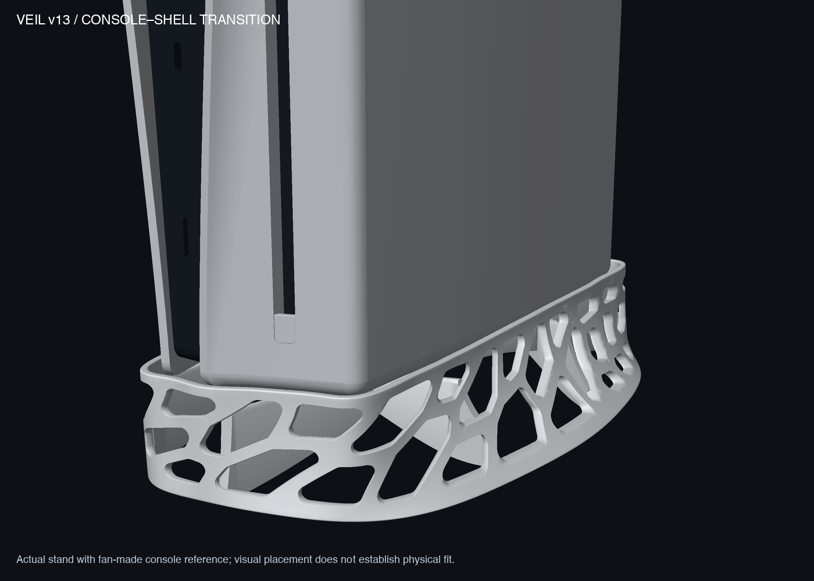

# Veil v13 — quieter continuous perimeter loops

保留用户认可的连续网壳和下方轮廓，把上沿改为接近等高的回环，并平滑下沿局部急弯。**这是可审查的设计与仿真样件，不是已验证的量产支架。**



[Standalone shell](output/hero_v13.png) · [Four views](output/preview_v13_clean.png) · [Full reference assembly](output/reference_assembly_clean.png) · [Flat side profile](output/side_profile_flat.png)

The upper perimeter now ranges from **38.03 to 40.70 mm**, versus v12's 33.95–48.04 mm. The lower contact loop stays planar. Both perimeter guides use finite Fourier series, with continuous position, tangent and curvature at the periodic seam. This statement concerns the mathematical guides; it does not certify the entire triangulated shell as G2. The lower outline moves at most 1.62 mm from v12, retaining its overall character.

Overall size is **150.34 × 241.28 × 40.70 mm**, geometric volume **74.61 cm³**. The 72 rounded flowing openings, nominal 2.8 mm shell, 30 mm seat and inherited nominal 1.5 mm clearance remain. The fan-made console reference is not a scan or physical fit certificate.

| Deliverable | Purpose |
|---|---|
| [3MF](output/veil_v13_prototype.3mf) / [STL](output/veil_v13_prototype.stl) | Manufacturing prototype geometry, millimeters; no printer settings |
| [Source](source/veil_v13.py) / [geometry method](GEOMETRY_METHOD.md) | Editable generator and continuity evidence |
| [Fit gauge](output/GAUGE_v13_cavity_1.6mm.stl) | 106.91 × 227 × 1.6 mm; byte-identical to v12; not load-bearing |
| [Print coupon](output/PRINT_TEST_v13_section.stl) | 58 × 36 × 40.70 mm, 6.93 cm³; actual shell/support crop |
| [Vendor brief](PRINT_SERVICE.md) | English/Chinese prototype and process checks |

## Geometry evidence

STL and 3MF agree in size and volume. The body has 170,792 triangles and is one watertight component with consistent winding. The inherited cavity is unchanged; console-plan and nominal-cavity intersections are both 0 mm³. This checks the reference envelope, not the actual console. The sampled opening separation is at least 3.043 mm on the checked mapped maximum-bevel boundaries, not a complete final-wall-thickness certificate. See [geometry readback](analysis/light_geometry_review.json), [guide continuity](analysis/guide_continuity.json), [opening screen](analysis/aperture_spacing_preflight.json) and [hashes](output/deliverable_hashes.json).

## Engineering status

Fresh v13 FEA found **unconverged stress concentrations in the internal support structure**, so this is not a strength pass or a service-use print release. Under the assumed 31.392 N vertical load, maximum displacement spans 0.149–0.157 mm across three meshes, while peak von Mises stress spans **21.61–51.25 MPa** and moves between locations. Small/sliver tetrahedra, approximated geometry, clamped feet and unverified real contact limit peak interpretation. The 10 N side case is a local push on the stand, not a push at the top of the console. Material is assumed isotropic E=1200 MPa, ν=0.35; no measured printed-material allowable or safety factor is available.

Read the [structural report](STRUCTURAL_ANALYSIS.md), [rotatable stress viewer](output/stress_heatmap_3d.html) and [mesh-quality review](analysis/fea_review.json). Colors show stress, not temperature. The internal junctions and contact geometry need refinement/verification before load qualification; no unsupported geometry change was made merely to hide an unstable numerical peak.

The user confirmed **CFI-20xx**, and “bottom sealed” means an impermeable solid desktop with side mesh openings left open. A fresh low-Reynolds-number airflow calculation compares the same hypothetical capped, 30 mm tall channel with and without the stand. With a central assumed suction port, conductance is **20.9–25.4% lower** across 3, 2 and 1.5 mm grids. An offset hypothetical port is more restricted. These are surrogate-channel results, **not percentages of actual PS5 cooling loss**; spatial convergence, real vent geometry and the fan operating point are not established.

Read the [airflow review](airflow/AIRFLOW_REVIEW.md), [flow sections](airflow/flow_sections.png), [3D flow view](airflow/flow_streamlines_3d.png) and [numerical summary](airflow/summary.json). The model does not predict temperature. Slim teardown imagery shows a lower rear grille; this rim sits 8.03–10.70 mm above the seat, and its actual clearance to that grille is unresolved. The fan-made exterior cannot identify the true active underside vent map. **We cannot yet assure that the lower passage has no adverse effect on PS5 ventilation.**

No physical fit, printing, sustained-load, creep or thermal qualification has been performed. Historical v7 stress results do not validate v13. The next useful engineering work is verified hardware contact/vent dimensions and internal-junction refinement with improved local meshes, followed by process-specific samples and testing.

## Reproduce

Use Python 3.13 and the CAD dependencies in `source/requirements.txt`, from the repository root:

```sh
.venv-cad/bin/python designs/v13/source/veil_v13.py designs/v13/output
.venv-cad/bin/python designs/v13/source/review_guides.py
.venv-cad/bin/python designs/v13/source/review_final_geometry.py
.venv-cad/bin/python designs/v13/source/review_aperture_spacing.py
.venv-cad/bin/python designs/v13/source/render_clean.py
```

Reference assets and shared rendering helpers retain repository-relative paths. Editable geometry is Python, not STEP/B-rep. Actual render metadata records the STL hash.
