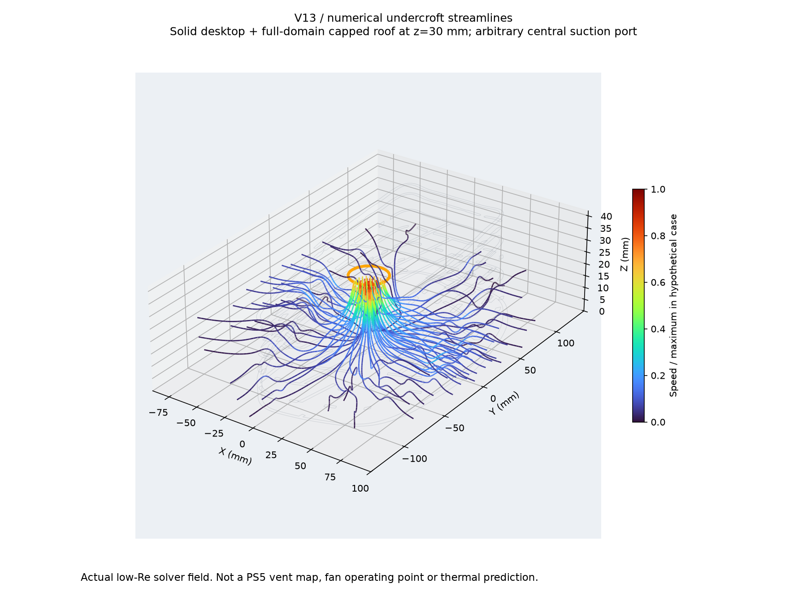
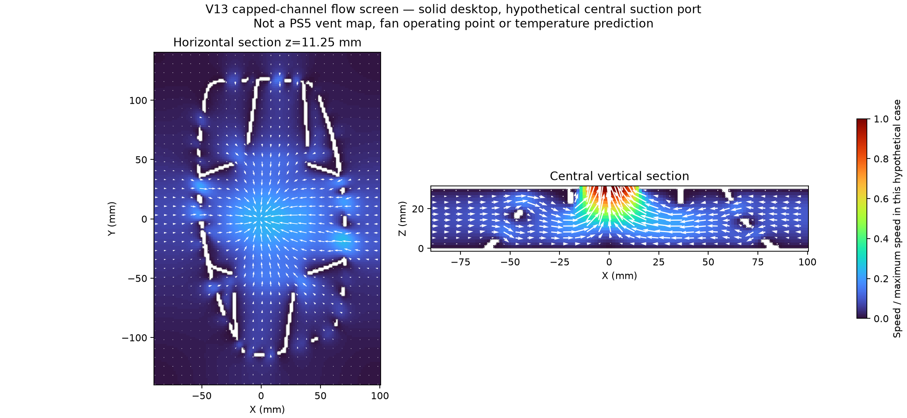

# v13 ventilation evidence and conditional flow screen

**The open lower mesh is not a sealed chamber, but we cannot yet say that it leaves the real PS5 Slim ventilation unaffected.** The documented lower rear grille needs a hardware clearance check. The numerical results below are a deliberately capped-channel sensitivity study using the actual stand geometry below its seat, **not a simulation of the actual console cooling system**.

User-confirmed configuration: **CFI-20xx; solid, impermeable desktop underneath; side mesh open.** Final CAD SHA-256: `bea7633ae9056bdd5e5f3f4c0e4ced1c9958bf9ea5c77ac0db26fd036f9fed11`.

## What the evidence establishes

| Region | Evidence | What remains unknown |
|---|---|---|
| Side and rear vents | [Sony ventilation support](https://www.playstation.com/en-us/support/hardware/ps5-console-noise/) identifies these as regions to keep unobstructed and calls for at least 10 cm of free space around each side. | Exact active area, split of flow between openings, local pressure and revision-specific geometry. |
| Fan beneath upper side cover | [iFixit Slim fan replacement, steps 3–8](https://www.ifixit.com/Guide/PlayStation+5+Slim+Fan+Replacement/167652) documents its position. | This does not establish a bottom-facing intake port. |
| Lower rear grille beside rear connections | [iFixit Slim power-supply replacement, step 17](https://www.ifixit.com/Guide/PlayStation+5+Slim+Power+Supply+Replacement/168012), [rear housing photo](https://guide-images.cdn.ifixit.com/igi/66BRjLfBZgMySYOP.medium), visibly shows rear grille slots beside the AC and I/O panel extending toward the base. | These photos are uncalibrated; the bottom edge of each active passage is not measured. |
| Bottom end face and PSU | [Same guide, step 28 photo](https://guide-images.cdn.ifixit.com/igi/RbdSBGCYQ1dSXpNM.medium) shows the base end face and surrounding housing after disassembly. The visible end face appears largely closed. | This is an oblique, partially disassembled view, not a complete underside scan. Small gaps and internal PSU passages cannot be classified as active intakes or outlets from it. |
| Front trim | [iFixit Slim front-trim guide](https://www.ifixit.com/Guide/PlayStation+5+Slim+Front+Trim+Assembly+Replacement/168014) documents power-button, USB-C and antenna assembly. | It does not supply a dimensioned intake map or fan curve. |

**Clearance concern:** v13's rim stands approximately **8.03–10.70 mm above the 30 mm console seat**. The rear portion therefore needs checking against the lowest real rear grille slots, including open space outside them. An inherited 1.5 mm nominal cavity clearance is a fit assumption, not a ventilation clearance. No rear-rim alteration has been made on the basis of an uncalibrated photograph. Coordinate labels on the fan-made mesh are not a verified hardware orientation map.

The supplied GLB contains exterior parts with anonymous names and no verified internal duct/fan/heat-sink geometry. Its black-core exterior has about 4,110 triangles. Modeling can measure features that exist in the source, but cannot recover absent hidden vents or establish their flow direction. There is no evidence-backed circular port at the location used in the screening simulation below.

## Numerical model actually solved

`lbm.cpp` solves a 3D, isothermal D3Q19 BGK lattice-Boltzmann flow field, with halfway link bounce-back at solid walls and pressure reservoirs using non-equilibrium extrapolation. The boundary approach follows [Guo, Zheng and Shi (2002)](https://cpb.iphy.ac.cn/article/doi/10.1088/1009-1963/11/4/310); this is an independently implemented screening solver, not a validated commercial console CFD model.

- Domain: approximately 190 × 280 × 30 mm. Desktop at z=0 is impermeable/no-slip.
- **A no-slip roof caps the entire rectangular domain at z=30 mm**, except for an assumed 30 mm diameter circular port. This is larger than the console footprint and deliberately confines the channel. It suppresses exterior upward escape; it is not the actual console exterior and is not proven to bound every real operating case.
- All four outer side faces are ambient-pressure reservoirs. Stand solids below z=30 come from rasterized exact STL slices. No stand is used for the paired empty-channel reference; both cases otherwise use the same domain and nominal port.
- Central port at (x,y)=(0,0), and a separate port-location sensitivity at (0,60) mm. These locations are **hypothetical**. Reservoir cells whose adjacent interior cell is solid are closed; this captures blockage of the nominal assumed port by supports, rather than extrapolating pressure from solid nodes.
- Density difference 10^-5, relaxation time 0.8, lattice viscosity 0.1. Maximum Mach number is below 0.00007 and domain-length Reynolds number below about 0.07. This is creeping/very-low-Re flow. No real air volume rate, fan curve, game load, heat input, temperature, turbulence or buoyancy is assigned.
- Central suction means side air enters the undercroft and exits upward through the assumed port. A reversed-pressure case represents a hypothetical downward discharge escaping through the side openings. Neither direction is assigned to the real PS5 bottom.

## Results and checks

| Central-port grid | Conditional conductance reduction versus empty capped channel | Voxel solid-volume error below seat | Maximum paired mass imbalance |
|---|---:|---:|---:|
| 3.0 mm | 20.86% | +1.99% | 0.00050% |
| 2.0 mm | 22.95% | −0.70% | 0.00030% |
| 1.5 mm | 25.41% | +0.76% | 0.000028% |

The stand changes the flow even though the voxel fluid domain remains connected. These percentages describe **this hypothetical capped channel at equal pressure difference**; they are not percentages of PS5 fan flow loss or temperature rise. Conductance has not converged spatially: the 2.0→1.5 mm change is about 2.47 percentage points, and the nominal 2.8 mm shell still spans fewer than two fine-grid cells. Stair-stepped walls, aperture sampling and the sampled port area (688–720 mm²) remain material uncertainties. Small total-volume error does not prove local throat accuracy.

Moving the hypothetical port to y=60 mm on the 3 mm grid changes the reduction to **53.73%**; support geometry blocks part of that assumed port, reducing sampled open area from 720 to 594 mm². This is a useful warning that the real vent position matters; it is **not** evidence that the PS5 suffers that restriction.

Reversing central pressure on the 3 mm grid changes flux magnitude by **0.0070%**, consistent with near-linear low-Re behavior. It provides a conditional outward-flow case, not a real exhaust-temperature prediction.

Verification:

- Analytical fully developed rectangular-duct benchmark: **0.0576% flux error** for this solver and its pressure-boundary implementation.
- All completed cases reach relative velocity-field change below 10^-6 over the last 250 steps.
- Flux balance uses **all discrete links crossing each reservoir interface**, including diagonals. Worst completed case mass imbalance is **0.000605%**. Earlier cell-center planar estimates were inconsistent near the port and are not used.
- Boundary extrapolation neighbors are checked to be fluid. Each stand fluid grid has one connected component.
- Final results, cases and CAD identity: [summary.json](summary.json). These checks establish solver consistency in the stated model, not adequacy of the unknown hardware boundary conditions.





The graphics show the actual 1.5 mm numerical velocity field, normalized to its own maximum, with CAD section outlines. The orange circle is the **assumed port**, not a found PS5 opening. Streamlines are trilinear interpolations of the lattice field. Neither graphic is a temperature heatmap.

## Design consequence and remaining work

Keep the open lower mesh and avoid adding a solid bottom cover or pads across openings. **Do not sign off the current stand as ventilation-safe yet.** Before turning this conditional screen into actual assembly CFD, measure the CFI-20xx bottom/rear vent layout relative to the seat and support contacts, check which rear grille portions lie below/behind the rim, and obtain credible internal flow/fan boundary data. A scan or dimensioned photographs can constrain geometry, but flow direction/active ports still need evidence or measurements. Controlled comparison with the official stand remains needed for thermal qualification. The present model does not justify modifying ribs around an invented intake.

## Reproduce

From the repository root, using the CAD environment (numpy, scipy, trimesh, manifold3d, scikit-image; pyvista and matplotlib for figures):

```sh
clang++ -O3 -std=c++17 designs/v13/airflow/lbm.cpp -o /tmp/veil-lbm
.venv-cad/bin/python designs/v13/airflow/benchmark.py
.venv-cad/bin/python designs/v13/airflow/run_screen.py 3
.venv-cad/bin/python designs/v13/airflow/run_screen.py 2
.venv-cad/bin/python designs/v13/airflow/run_screen.py 1.5
.venv-cad/bin/python designs/v13/airflow/run_screen.py 3 60
.venv-cad/bin/python designs/v13/airflow/run_screen.py 3 0 --reverse
.venv-cad/bin/python designs/v13/airflow/summarize.py
MPLCONFIGDIR=/tmp/veil-mpl .venv-cad/bin/python designs/v13/airflow/render_flow.py
```

Field NPZ and raw logs are local regeneration outputs; scripts, result JSON, report and PNGs are the review deliverables. No production CFD acceptance is claimed.
