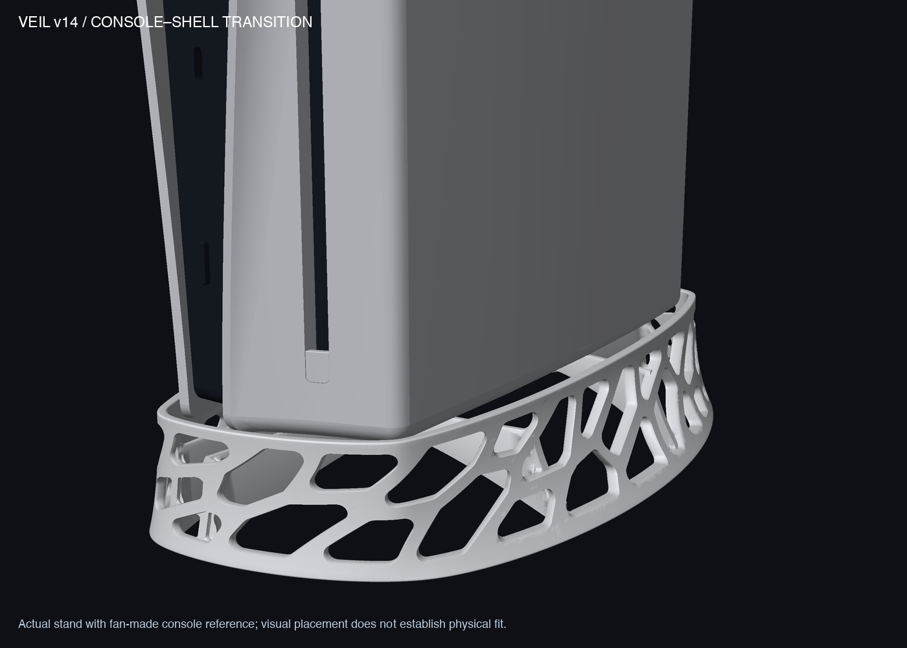
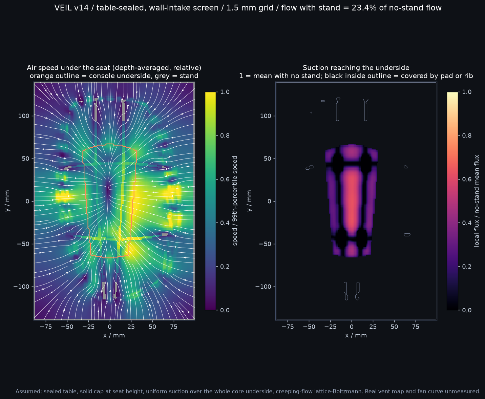
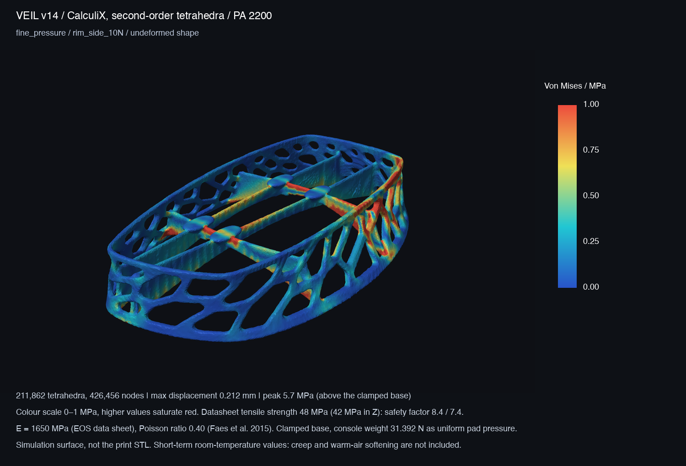
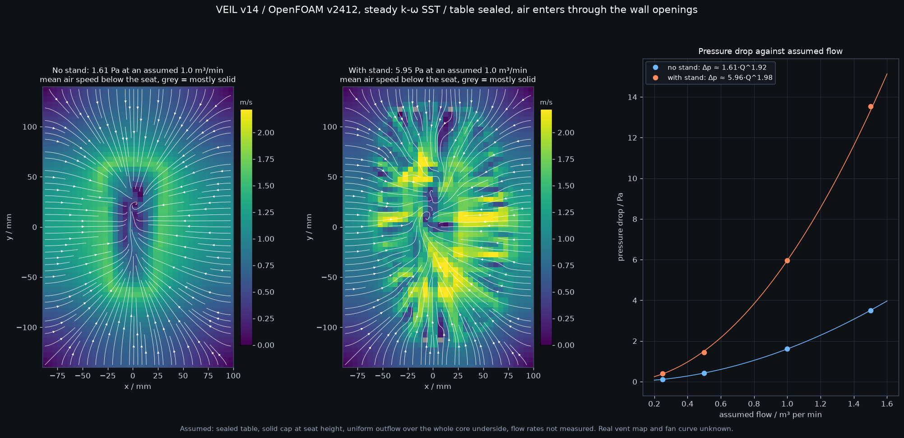

# Veil v14 — convex wall, seat pads, open-arch ribs, stiffened long sides, blended rib feet

v14 keeps v13's perforated shell and opening pattern, and changes these things: the exterior wall is rebuilt as a strictly convex surface, the console now rests on four flat pads instead of narrow rib crests, the ribs are rerouted under those pads with filleted crossings, the wall is thickened inward by up to 0.7 mm where it stands clear of the console, and each rib's underside is a wider, flatter arch to let more air through, and every rib end is blended into the wall with a fillet. **This is a design and screening prototype, not a qualified stand.** Nothing has been printed or tested on hardware. The print plan is in [PRINT_SERVICE.md](PRINT_SERVICE.md). v13 is untouched.



[Standalone shell](output/hero_v14.png) · [Four views](output/preview_v14_clean.png) · [12-angle turntable](output/turntable_v14.png) · [v13 turntable for comparison](output/turntable_v13.png) · [Flat-shaded side profile](output/side_profile_flat.png)

Overall size is **152.83 × 247.08 × 40.70 mm** (v13: 150.34 × 241.28 × 40.70), volume **79.26 cm³** (v13: 74.61). Seat height 30 mm, 1.5 mm nominal cavity clearance, 72 openings and the rim height guide are inherited; the shell is 2.8 mm at the tight ends and 3.5 mm along the long sides (v13: 2.8 mm throughout). The fit gauge has the same extents as v13's.

| Deliverable | Purpose |
|---|---|
| [3MF](output/veil_v14_prototype.3mf) / [STL](output/veil_v14_prototype.stl) | Prototype geometry, millimetres; no printer settings |
| [Source](source/veil_v14.py) | Editable generator |
| [Fit gauge](output/GAUGE_v14_cavity_1.6mm.stl) / [print coupon](output/PRINT_TEST_v14_section.stl) | Cavity outline check; shell/support crop |

## 1. Exterior wall

v13's rim and base guides were smoothed radial functions; the smoothing left ripples that were not in the console outline (the console's clearance outline is within 1.46 mm of its own convex hull). v14 fits each guide as a Fourier series of the curve's **support function**, where "convex" and "clears the console" are both linear constraints.

| Measure (analytic guide surface) | v13 | v14 |
|---|---:|---:|
| Direction changes in rim outline | 50 | 0 |
| Inward-curving rim length | 242 mm | 0 mm |
| Direction changes at mid-wall / base | 38 / 4 | 0 / 0 |
| Significant curvature peaks and dips around rim | 42 | 8 |
| Tightest rim radius | 6.6 mm | 10.7 mm |
| Silhouette kinks summed over 12 view angles | 67 | 0 |
| Steepest wall lean from vertical | 54.7° | 43.6° |
| Rim-to-cavity gap | 3.95–10.84 mm | 4.08–17.17 mm |

Cost: the rim sits up to 17 mm from the cavity outline at mid-sides (v13: 11 mm), and the footprint grows 2.5 mm × 5.8 mm. These numbers describe the analytic guide surface, not the opening edges or the triangulated mesh. Evidence: [wall_smoothness.json](analysis/wall_smoothness.json), from `source/review_wall.py`.

## 2. Seat contact

Measured against the flat bottom of the fan-made reference core (not a scan of real hardware), assuming 3.2 kg:

| | v13 | v14 |
|---|---:|---:|
| What touches the core | 3 rib crests, each 1.54 mm wide (4th rib misses the core) | 4 pads, each 21.6 × 10.6 mm flat land |
| Nominal contact area | 349 mm² | 771 mm² |
| Mean pressure | 0.090 MPa | 0.041 MPa |
| Closest contact to core edge | 0 mm | 6.6 mm |
| Stand material in the core-to-cover slot | 418 mm³ | 0.5 mm³ |

- Wall thickness follows the radial rim-to-cavity gap: 2.8 mm where the gap is under 5 mm, rising smoothly to 3.5 mm where it exceeds 10 mm (about 80% of the perimeter is above 3.3 mm). It grows inward only.
- Pads are 24 × 13 mm rounded outlines centred at (±16.5, 44) and (±11.5, −44) mm, with a 1.5 mm rolled edge and a 45° self-supporting underside.
- Pad tops are **flat**, not crowned: a crown on a rigid pad would recreate a small contact spot.
- Rib crests are at 29 mm, 1 mm below the seat, so nothing but the pads touches the console. Each rib is a single arch 7 mm deep at mid-span; its underside follows 22·sin(πs) mm along the rib (v13 and earlier v14 builds used sin², which left much less open area near the ends).
- The reference core's centroid lies inside the pad quadrilateral with 15.4 mm margin (v13's contact hull gave 23.0 mm); the pad pair at −y is narrower because the core bottom narrows there.
- Rib crossings carry a plan fillet growing to 3 mm radius, replacing v13's sharp vertical inside corners. Stress results for this geometry are in sections 4 and 5.
- **Rib feet.** Each of the eight rib ends is blended into the wall with a rolling-ball fillet: 3 mm radius inside the wall's inner face, 1.5 mm inside the wall thickness. The second part matters most: one cross-rib end crosses a wall opening and used to touch the opening's lower rim at a single point, which was the highest stress in the part (section 5). The fillets add 0.73 cm³ (0.9%). They are built from a 0.1 mm voxel model of the junction, so their surface is slightly faceted. From outside, the opening that this rib end crosses now shows a small rounded pocket where there was a sharp gap, and a blend is visible behind the opening above it; the openings' own outlines are unchanged. **This visible change has not been reviewed for appearance.** [Outside view, before and after](output/rib_foot_opening_before_after.png) · [rib feet from inside, before and after](output/rib_foot_fillets_before_after.png) · [volumes per foot](analysis/foot_fillets.json).

Neither pressure is high enough to damage the console housing; the change is about defined, edge-free, symmetric support. Evidence: [seat_contact.json](analysis/seat_contact.json), from `source/review_seat.py`.

## 3. Airflow (in-house lattice-Boltzmann screen)

**The real CFI-20xx vent positions and fan operating point are still unmeasured, so nothing here shows that the console's intake works.** Both screens are relative comparisons at equal suction ([method and limits](../v13/airflow/AIRFLOW_REVIEW.md)): solid table at z = 0, solid cap at seat height, open sides, creeping-flow lattice-Boltzmann.

### Assumed 30 mm port

| Case | v13 flow reduction | v14 flow reduction |
|---|---:|---:|
| Central port, 3 mm grid | 20.86% | 27.80% |
| Central port, 2 mm grid | 22.95% | 20.98% |
| Central port, 1.5 mm grid | 25.41% | 23.52% |
| Port moved to y = 60 mm, 3 mm grid | 53.73% | 31.31% |

v14 is about 2 points less restrictive than v13 on the two finer grids and 22 points less with the port off-centre. The 3 mm grid is worse because the grid closes 36 mm² of the assumed port (684 of 720 mm² open). Results are not grid-converged.

### Table-sealed, wall-intake case

Air can only arrive sideways through the wall openings, and suction is spread over the **whole flat underside of the reference core** (about 70 cm²). "Flow kept" is flow with the stand divided by flow with no stand at the same suction.

| Grid | v13 flow kept | v14 flow kept |
|---|---:|---:|
| 3 mm | 27.8% | 25.9% |
| 2 mm | 24.9% | 24.5% |
| 1.5 mm | 23.5% | 23.4% |



- The stand removes roughly three quarters of the easy flow in both versions; v14 matches v13 on the finest grid. The rib-foot fillets cost 0.1 points (23.5% to 23.4%). The no-stand reference is a console hovering 30 mm above the table with nothing around it, which is a very open baseline.
- The wall alone keeps 38.3% (2 mm grid, measured before the rib-foot fillets were added), so the wall and the seat structure matter about equally.
- Rib shape was explored on the 2 mm grid, also before the fillets. Dropping the ribs 4 mm below the console made flow worse (22.4% kept) and tripled peak stress, because the main air path is under the ribs, not over them. The wider arch adopted here raised flow kept from 22.8% to 24.6%. A still thinner, wider arch reached 26.1% but tripled the deflection under weight, so it was not adopted.
- Wall openings total about 112 cm², of which about 92 cm² are below seat height (v13: 116 and 97); that exceeds the underside area being fed.
- Rough scale only, from the pre-arch build: at an *assumed* 1 m³/min the solved creeping-flow resistance gives about 0.2 Pa and an orifice-type estimate through the below-seat openings about 5 Pa. Neither is a prediction for the real console. The OpenFOAM sweep in section 6 replaces this estimate.

Results: `airflow/summary.json`, `airflow/*_portcore.json`; map from `airflow/render_sealed.py`.

## 4. Stress screen (in-house, first-order elements)

Same method as [v13's structural analysis](../v13/STRUCTURAL_ANALYSIS.md): scikit-fem, first-order tetrahedra on a smoothed simulation-only surface, E = 1,200 MPa and Poisson ratio 0.35 (illustrative), clamped base, 31.392 N as uniform pressure on the pad tops (750 mm²; v13: 265 mm² of rib crest). **Kept for comparison with v13. Section 5 shows these first-order results understate deflection by about half.**

| Case, finer mesh | | v13 | v14 |
|---|---|---:|---:|
| Console weight | Max displacement | 0.157 mm | 0.130 mm |
| | Stress below which 95% of the material sits | 0.42 MPa | 0.43 MPa |
| | Raw peak | 51.3 MPa | 20.2 MPa |
| Weight plus 10 N sideways on the +x rim | Max displacement | 0.223 mm | 0.185 mm |
| | 95% stress | 0.50 MPa | 0.49 MPa |
| | Raw peak | 51.6 MPa | 20.3 MPa |

- Design history under this screen: with a 2.8 mm wall v14 was 36% more flexible than v13 under the side push (0.304 mm). Thickening the wall inward to 3.5 mm along the long sides brought that to 0.201 mm. The wider rib arch then traded some weight stiffness for airflow (0.078 mm to 0.137 mm under weight). The rib-foot fillets recovered a little (0.130 mm), leaving both cases stiffer than v13.
- Raw peaks here sit in badly shaped elements and are not a material stress: 22.3 MPa on the coarse mesh, 20.2 MPa on the finer one and 19.7 MPa on the optimized-quality TetGen mesh (which could be built this time), all in a sliver element with a quality measure below 0.001. Use section 5 for peak stress.
- The uneven-weight case is not comparable with v13: it loads faces at x > 8 mm, which is one small rib patch in v13 and two whole pads in v14 (0.181 mm, 20.1 MPa raw peak).

Meshes: 552,762, 677,673 and (quality) 669,103 tetrahedra. Simulation surface versus CAD: −1.25% volume, 0.19 mm at the 95th percentile, 0.57 mm maximum sampled deviation. Heatmaps: [weight](output/v14_fine_result_vertical_1g_stress.png) · [uneven weight](output/v14_fine_result_eccentric_1g_stress.png) · [side push](output/v14_fine_result_rim_side_10N_stress.png). Data: [fea_review.json](analysis/fea_review.json), `analysis/v14_*_result.json`.

## 5. Stress with Gmsh + CalculiX and PA 2200 properties

### Reference material

EOS PA 2200 (laser-sintered PA12, white), from the [EOS material data sheet](https://www.eos.info/polymer-solutions/polymer-materials/data-sheets/mds-pa-2200) ("PA 2200 Balance", 120 µm layers, status 12.11.2026). The sheet does not name a machine, so **P 396 is not confirmed by the source**. All values are dry, short-term, room-temperature.

| Property | X / Y | Z (build direction) | Standard |
|---|---:|---:|---|
| Tensile modulus | 1,650 MPa | 1,650 MPa | ISO 527 |
| Tensile strength | 48 MPa | 42 MPa | ISO 527 |
| Strain at break | 18% | 4% | ISO 527 |
| Heat deflection, 1.80 MPa | 64 °C | 57 °C | ISO 75 |
| Heat deflection, 0.45 MPa | 157 °C | 145 °C | ISO 75 |
| Density | 0.93 g/cm³ | | EOS method |

Poisson's ratio is **not on the data sheet**. The model uses 0.40, from [Faes et al. 2015](https://utw10945.utweb.utexas.edu/sites/default/files/2015/2015-69-Faes.pdf), who measured 0.3967 (uniaxial) and 0.41 (full-field) on PA 2200 from an EOS P395. At 78.54 cm³ the part weighs about 73 g.

### Model

- **Mesh:** Gmsh could not mesh the print STL directly ("two exactly self-intersecting facets"), and its surface reparametrisation failed on both the print STL and the simulation surface ("wrong topology of boundary mesh"). The mesh therefore starts from the existing simulation surface (`analysis/regularized.stl`), is remeshed isotropically with MMG 5.8 (target edge 0.45× around the pads and rib crossings, 0.55× on the +x wall struts), and is then filled by Gmsh 4.15 (HXT) and raised to **second-order tetrahedra** (C3D10). Mid-side nodes sit on straight edges.
- **Solver:** CalculiX 2.20, linear elastic, clamped base (nodes within 0.2 mm of the lowest point). The multi-threaded SPOOLES solver returned wrong, unbalanced answers on the fine mesh (25 N reaction for a 31 N load), so every run uses one solver thread and is checked for force balance.
- **Loads:** the same three cases. In the pressure model the weight is a uniform pressure on the pad tops. In the contact model the console is a rigid flat plate resting on the pads through frictionless contact, with the weight applied at the core centroid (and 10 mm towards +x for the uneven case), so pad loads follow from equilibrium.

| Mesh | Surface tolerance | Tetrahedra | Nodes | Volume vs simulation surface | Worst element quality (gamma) |
|---|---:|---:|---:|---:|---:|
| Coarse | 0.60 mm | 101,577 | 211,050 | −3.66% | 0.125 |
| Fine | 0.35 mm | 211,862 | 426,456 | −0.64% | 0.097 |
| Extra-fine | 0.20 mm | 296,577 | 608,679 | +0.47% | 0.093 |

No element is below 0.05 on any mesh. The coarse surface is visibly thinner than the geometry, so treat it as a lower-fidelity check only.

### Results, uniform pressure

| Case | | Coarse | Fine | Extra-fine | Extra-fine before the rib-foot fillets |
|---|---|---:|---:|---:|---:|
| Console weight | Max displacement | 0.186 mm | 0.169 mm | 0.168 mm | 0.180 mm |
| | 95% stress | 0.57 MPa | 0.54 MPa | 0.53 MPa | 0.55 MPa |
| | 99.9% stress | 1.68 MPa | 1.59 MPa | 1.56 MPa | 1.65 MPa |
| | Peak anywhere above the base (at the pad and rib crossings) | 4.6 MPa | 4.9 MPa | 4.7 MPa | 15.5 MPa (rib foot) |
| Uneven weight | Max displacement | 0.258 mm | 0.238 mm | 0.234 mm | 0.246 mm |
| | Peak anywhere above the base | 5.3 MPa | 5.8 MPa | 6.1 MPa | 16.4 MPa |
| Weight + 10 N side push | Max displacement | 0.226 mm | 0.212 mm | 0.209 mm | 0.231 mm |
| | Peak, +x wall struts (the highest in this case) | 5.7 MPa | 5.7 MPa | 6.6 MPa | 7.1 MPa |



- **Displacement and bulk stress converge** (within 2% between the two finer meshes).
- **The rib-foot peak is gone.** Before the fillets the highest stress was at about (−51.4, −38.7, 5.5) mm and rose with mesh refinement (11.3, 11.2, 15.5 MPa). A close look showed why: that cross-rib end crosses a wall opening and touched the opening's lower rim at a single point. With the rim blended in, the highest stress under the console's weight moved to the pad and rib crossings and holds steady across the three meshes (4.6, 4.9, 4.7 MPa).
- **Two peaks are still creeping up** with refinement and are not converged: the uneven-weight peak at a pad root (5.3, 5.8, 6.1 MPa) and the wall-strut peak under the side push (5.7, 5.7, 6.6 MPa).
- **Safety factor against the data-sheet tensile strength, uniform pressure, highest value found (6.6 MPa, side push, extra-fine):** 7.2 in X/Y and 6.3 against the Z strength (before the fillets: 2.9 and 2.6). 99.9% of the material is at or below 2.0 MPa on the two finer meshes in every case. Short-term, room-temperature values only.
- Force balance: the base reaction is 31.05 to 31.17 N against 31.39 N applied, 0.7 to 1.1% low, because the pressure acts normal to pad-top faces that are not perfectly flat on the simulation surface. The contact model below balances exactly.

### Results, rigid-plate contact

| Case | | Coarse | Fine | Fine before the rib-foot fillets |
|---|---|---:|---:|---:|
| Console weight | Max displacement | 0.113 mm | 0.115 mm | 0.126 mm |
| | 99.9% stress | 1.32 MPa | 1.33 MPa | 1.38 MPa |
| | Peak above the base | 4.0 MPa | 6.4 MPa | 8.9 MPa (rib foot) |
| Uneven weight (load point +10 mm in x) | Max displacement | 0.134 mm | 0.133 mm | 0.147 mm |
| | 99.9% stress | 1.52 MPa | 1.46 MPa | 1.59 MPa |
| | Peak above the base | 4.7 MPa | 8.1 MPa | 9.4 MPa (rib foot) |
| Weight + 10 N side push | Max displacement | 0.217 mm | 0.204 mm | 0.230 mm |
| | 99.9% stress | 1.67 MPa | 1.66 MPa | 1.75 MPa |
| | Peak above the base | 5.9 MPa | 7.2 MPa | 8.7 MPa (rib foot) |

All six runs converged in 21 to 24 iterations with exact force balance (31.392 N vertical, 10.00 N sideways in the side-push case).

- **Displacement and bulk stress converge** between the two meshes: within 2% under weight and uneven weight, 6% under the side push. The plate keeps the four pads level, so the stand deflects about a third less than under uniform pressure (0.115 mm against 0.169 mm on the fine mesh).
- **The contact peak does not converge.** On the fine mesh it sits on a pad's top edge at (22.7, 46.1, 29.3) mm, where the rigid plate bears on the pad's rolled edge, and it rises from 4.0 to 6.4 MPa under weight (4.7 to 8.1 MPa uneven). A rigid, perfectly flat plate on a slightly uneven simulated pad surface concentrates the load on a few points; the real console underside is neither rigid nor perfectly flat. Treat these as upper-end local contact values, not converged results.
- **Highest stress found in any run: 8.1 MPa** (uneven weight, fine contact), a factor of 5.9 on the X/Y strength and 5.2 on the Z strength.

Pad loads, from the solver's contact force on each pad (they sum to 31.39 N in every run):

| Pad centre (x, y) mm | Weight, coarse / fine | Uneven weight, coarse / fine | Side push, coarse / fine |
|---|---:|---:|---:|
| (−16.5, 44) | 7.9 / 9.3 N | 4.9 / 5.9 N | 7.1 / 8.5 N |
| (16.5, 44) | 9.1 / 8.1 N | 12.1 / 11.6 N | 9.9 / 8.9 N |
| (−11.5, −44) | 7.8 / 8.3 N | 5.0 / 5.4 N | 8.8 / 9.3 N |
| (11.5, −44) | 6.6 / 5.6 N | 9.4 / 8.5 N | 5.6 / 4.6 N |

- Every pad stays loaded in every case; the smallest share is 15% (4.6 N).
- Under plain weight the split is 18 to 30% per pad, not 25% each. An even split would be 7.85 N.
- The split moves by up to 1.5 N between the two meshes, so it is sensitive to pad-top height differences of a few hundredths of a millimetre. On a printed part, flatness of the four pad tops will decide the real split.

Heatmaps: [weight](output/ccx_fine_contact_vertical_1g_stress.png) · [uneven](output/ccx_fine_contact_eccentric_1g_stress.png) · [side push](output/ccx_fine_contact_rim_side_10N_stress.png) on the fine mesh; coarse-mesh and uniform-pressure versions are in `output/ccx_*`.

### Solver change versus material change

Console weight, uniform pressure, max displacement. **Steps 1 to 3 were run on the mesh from before the rib-foot fillets and were not repeated**; they compare solvers and element types, which does not depend on the fillets. Step 4 is the current geometry (0.183 mm before the fillets).

| Step | Model | Displacement |
|---|---|---:|
| 1 | scikit-fem, first-order, in-house mesh, E 1,200 / ν 0.35 | 0.137 mm |
| 2 | Same, PA 2200 (E 1,650 / ν 0.40) | 0.0973 mm |
| 3 | CalculiX, first-order, the identical mesh and loads, PA 2200 | 0.0973 mm |
| 4 | CalculiX, second-order, Gmsh fine mesh, PA 2200 | 0.169 mm |

- **Material (1 → 2):** deflection falls 29%, as expected from the stiffer modulus.
- **Solver (2 → 3):** no difference to three figures; the two codes agree on the same mesh. The side-push case also matches (0.1463 mm in both).
- **Element order and mesh (3 → 4):** deflection nearly doubles. First-order tetrahedra are artificially stiff in thin bending members, so **every first-order displacement in section 4 and in v13's report is too low by roughly half**. Relative v13/v14 comparisons there still hold; absolute values do not.

### Still missing

- **Creep:** PA12 creeps under a constant load, and the console sits on the stand indefinitely. The data sheet gives no creep modulus, so long-term sag is not estimated.
- **Warm air:** the 1.80 MPa heat-deflection temperature is 64 °C (57 °C in Z) and stiffness falls well before that. Stresses here are far below 1.80 MPa in almost all of the part, but no temperature-dependent modulus was available and the air temperature around the stand is unmeasured.
- Layer-direction stiffness differences, moisture conditioning, impact, tipping and sliding are not modelled. The base is clamped, which hides lift-off and rocking.
- Results are on the simulation surface, not the print STL.

- **PETG:** numbers for the home fit-check material are in [PRINT_SERVICE.md](PRINT_SERVICE.md). PETG is not proposed for the final part.

Data: `ccx/*/results.json`, `ccx/mesh_*.json`, `ccx/surf_*.json`.

## 6. Airflow with OpenFOAM

Same table-sealed set-up as section 3: solid table at z = 0, solid cap at seat height, air enters sideways and leaves upward through a chimney with the outline of the reference core's underside (70 cm²). OpenFOAM v2412, steady `simpleFoam`, k-ω SST, air at 20 °C. The side faces are open to still air and the chimney draws a fixed flow.

**The flow rates are assumptions.** The console's real fan flow, vent positions and air temperature are unmeasured, so these are pressure drops of this idealised screen, not a cooling prediction.

| Assumed flow | No stand | With stand | Added by the stand | Ratio |
|---:|---:|---:|---:|---:|
| 0.25 m³/min | 0.11 Pa | 0.39 Pa | 0.28 Pa | 3.5 |
| 0.5 m³/min | 0.42 Pa | 1.45 Pa | 1.02 Pa | 3.4 |
| 1.0 m³/min | 1.61 Pa | 5.95 Pa | 4.34 Pa | 3.7 |
| 1.5 m³/min | 3.50 Pa | 13.54 Pa | 10.04 Pa | 3.9 |



- Pressure drop is the room's total pressure (zero) minus the area-average total pressure at the chimney top. It grows almost with the square of the flow (exponent 1.92 without the stand, 1.98 with it), so the losses are inertial, as through an orifice.
- The stand multiplies the pressure drop of this screen by 3.4 to 3.9. In absolute terms it adds about 4 Pa at 1 m³/min and 10 Pa at 1.5 m³/min. Whether that matters depends on the fan's pressure capability at its operating point, which is not known here.
- Meshes: 164,032 cells without the stand and 621,862 with it (2.5 mm base cells, stand surface refined two levels to 0.6 mm, no wall layers); `checkMesh` passes on every case. Mass balance is within 0.002%.
- **The steady solver does not reach its residual targets.** It settles into a small oscillation (velocity residuals around 0.01). Values are averages over iterations 1,005 to 1,500; the outlet pressure wobbles by up to 4% of the mean within that window (1.5 m³/min with the stand).

### Mesh check at 1.0 m³/min

| Case | Cells | Pressure drop | Change |
|---|---:|---:|---:|
| With stand, baseline | 621,862 | 5.95 Pa | |
| With stand, stand surface refined to level 3 (0.3 mm) | 2,106,153 | 5.73 Pa | −3.8% |
| With stand, base cell 1.8 mm | 1,295,152 | 6.23 Pa | +4.7% |
| No stand, baseline | 164,032 | 1.61 Pa | |
| No stand, base cell 1.8 mm | 446,107 | 1.95 Pa | +21% |

The with-stand result is good to about ±5%. **The no-stand baseline is not mesh-converged** (21% higher on the finer mesh), so the ratio is less certain than the absolute with-stand values: 3.7 on the baseline meshes and 3.2 on the 1.8 mm meshes.

### Against the lattice-Boltzmann screen (section 3)

| | Lattice-Boltzmann, 1.5 mm grid | OpenFOAM |
|---|---:|---:|
| Resistance with the stand ÷ without | 4.3 | 3.4 to 3.9 (3.2 on the finer meshes) |
| Flow kept at equal suction | 23% | 51 to 54% |
| Inflow share with the stand: −x / +x / −y / +y sides | 32 / 43 / 15 / 11% | 31 / 39 / 16 / 14% |
| Inflow share without the stand | 38 / 32 / 14 / 16% | 37 / 34 / 14 / 15% |

- **How restrictive the stand is:** the two models agree on the resistance ratio to within about 25% (4.3 against 3.2 to 3.9). They disagree on "flow kept", and that is physics, not error. The lattice-Boltzmann screen is creeping flow, where flow is proportional to suction, so a 4.3 times resistance leaves 23% of the flow. At the assumed flows the losses go with flow squared, so a 3.7 times resistance leaves 1/√3.7 = 52%. **Section 3's 23% overstates the loss at realistic flows; about half is the better figure for this screen**, with the mesh caveat above.
- **Where the air goes:** both models give the same picture. With the stand, about 70% of the air arrives through the two long sides and most through the +x side; without it the split is nearly the same on both long sides. The plan-view speed maps of the two models correlate at r = 0.81 (5 mm cells, each map normalised by its own mean).
- Neither model includes the console's real vents, warm exhaust, or the room.

Per-case numbers: [openfoam/summary.json](openfoam/summary.json). Scripts: `openfoam/make_case.py`, `run_case.sh`, `post_case.py`, `compare.py`. The case folders (3 GB) are not in Git.

## Still open

- **Appearance of one changed opening.** The rib end near (−51, −39) mm is now blended into the rim of the wall opening it crosses; from outside that opening shows a small rounded pocket ([before and after](output/rib_foot_opening_before_after.png)). Not yet reviewed for looks.
- **Two stress peaks still rise with mesh refinement:** the wall-strut peak under the side push (5.7, 5.7, 6.6 MPa) and the contact peak at a pad edge (4.0 to 6.4 MPa under weight). Both are far below the data-sheet strength, but neither is a converged number.
- **The OpenFOAM no-stand baseline is not mesh-converged** (+21% on the finer mesh), and the steady solver settles into a small oscillation instead of meeting its residual targets. A transient run or a finer baseline would tighten the stand/no-stand ratio.
- **Hardware unknowns:** real vent positions, fan flow, air temperature near the stand, and whether the rim overlaps the console's lower rear grille.
- **Not modelled:** creep, warm-air softening, tipping, sliding, lift-off at the base.
- **Not done:** slicing, the PETG fit check, the SLS order, any physical test. Ask the SLS service which PA12 powder they run.
- **PETG data sheet:** the PETG HF values in the print brief were read from a search-indexed copy of Bambu's V1.0 sheet and should be checked against the current one.

## Checks performed

STL and 3MF agree in bounds; the body is one watertight, consistently wound component; intersection with the reference console plan and the nominal cavity above the seat is 0 mm³ ([geometry_review.json](analysis/geometry_review.json)). Every result in this README was rerun on the final, filleted geometry (STL SHA256 `f1d0bfc2…`), except the solver cross-check in section 5 and the wall-only and rib-shape airflow explorations in section 3, which are marked. Not done for v14: opening-spacing preflight, slicing, printing, physical fit, thermal testing.

## Reproduce

Set-up, from the repository root. The solvers run in containers defined in [docker/compose.yaml](docker/compose.yaml).

```sh
git lfs install && git lfs pull
python3.13 -m venv .venv-cad
.venv-cad/bin/pip install -r designs/v14/source/requirements-fea.txt -r designs/v14/source/requirements-solvers.txt
docker compose -f designs/v14/docker/compose.yaml build ccx              # CalculiX 2.20
docker compose -f designs/v14/docker/compose.yaml pull openfoam          # OpenFOAM v2412 (arm64 and amd64)
```

- Git LFS carries the simulation surface, the in-house meshes, `ccx/mesh_*.msh`, `ccx/surf_*.stl`, each CalculiX case's `model.npz` and `*_fields.npz`, and the lattice-Boltzmann fields.
- Git-ignored and regenerated on demand: CalculiX `.inp` and `.frd`, in-house result arrays, other airflow arrays, and `openfoam/cases/` (3 GB).
- The fan-made console model in `references/console-model/` is needed by most scripts.
- `docker/Dockerfile.tools` (the Python toolchain in a container) is written but has never been built; the native venv is what was used.

Then:

```sh
.venv-cad/bin/python designs/v14/source/veil_v14.py designs/v14/output
clang++ -O3 -std=c++17 designs/v14/airflow/lbm.cpp -o /tmp/veil-lbm
VEIL_LBM=/tmp/veil-lbm designs/v14/source/run_checks.sh          # sections 1-4: reviews, renders, in-house stress and airflow

docker compose -f designs/v14/docker/compose.yaml build ccx
cd designs/v14/ccx
P=../../../.venv-cad/bin/python
$P ../source/remesh_surface.py ../analysis/regularized.stl 2.2 surf_fine.stl 0.35   # coarse: 3.0 ... 0.6, extra-fine: 2.2 ... 0.2
$P ../source/mesh_gmsh.py surf_fine.stl 2.2 mesh_fine.msh direct
$P ../source/build_ccx.py mesh_fine.msh fine_pressure pressure                      # or: fine_contact contact
../source/run_ccx.sh fine_pressure
$P ../source/post_ccx.py fine_pressure render
$P ../source/build_ccx_p1.py ../analysis/v14_fine_mesh.npz crosscheck_p1            # solver cross-check deck

$P ../source/post_ccx.py fine_contact render                                        # results.json, pad loads, heatmaps

cd ../openfoam
for q in 0.25 0.5 1.0 1.5; do for k in stand empty; do
  $P make_case.py cases/${k}_q$q $k $q 2.5 && ./run_case.sh cases/${k}_q$q && $P post_case.py cases/${k}_q$q; done; done
$P make_case.py cases/stand_q1.0_lvl3 stand 1.0 2.5 3 && ./run_case.sh cases/stand_q1.0_lvl3 && $P post_case.py cases/stand_q1.0_lvl3
$P make_case.py cases/stand_q1.0_h1.8 stand 1.0 1.8 && ./run_case.sh cases/stand_q1.0_h1.8 && $P post_case.py cases/stand_q1.0_h1.8
$P make_case.py cases/empty_q1.0_h1.8 empty 1.0 1.8 && ./run_case.sh cases/empty_q1.0_h1.8 && $P post_case.py cases/empty_q1.0_h1.8
$P compare.py                                                                       # summary.json and the figure
```

The generator takes about three minutes, most of it the rib-foot fillets. `VEIL_FOOT_FILLET=0` rebuilds the body without them (78.54 cm³, byte-identical to the first v14 export).

Timings on an 18-core Apple M5 Max with a 16 GB Docker VM: generator 3 min; `run_checks.sh` roughly 10 min; CalculiX pressure cases under 2 min each, fine contact 18 min for three cases side by side; OpenFOAM 2 min without the stand, 7 min with it, 25 min for the 2.1 M-cell check.

### Known problems and decisions

- CalculiX with a multi-threaded SPOOLES solver gave wrong answers. Keep `CCX_NPROC_EQUATION_SOLVER=1` (set in the compose file) and check the base reaction.
- Run the extra-fine CalculiX cases one at a time in a 16 GB Docker VM (`CCX_PARALLEL=1`); three at once ran out of memory.
- Pad loads come from one contact pair per pad and the solver's printed contact force (`*CONTACT PRINT, CF`). Summing nodal contact pressure from the `.frd` gave eleven times the applied load and was dropped.
- Neither Gmsh nor TetGen can mesh the print STL directly, so all stress work uses the smoothed simulation surface.
- The generator's export is sensitive: `VEIL_RIB_TOP` of 24 or 24.5 fails the watertight check. `export_mesh` steps to a finer simplification tolerance if the first one fails and records which it used in `analysis/foot_fillets.json` (the current build uses the original 0.008 mm).
- Rib-foot fillet variants that were tried and dropped: trimming the fillets with exact booleans against the wall (left slivers and failed export), removing thin parts with a morphological opening (removed most of the fillet, since fillets taper to nothing by nature), and keeping fillets out of the wall thickness entirely (left the point contact that caused the stress peak).
- Lowering the ribs to open a gap over them was tried and rejected (less flow, more stress).
- The run scripts are zsh: a glob that matches nothing aborts the command, so do not `rm` generated files by pattern before they exist.

