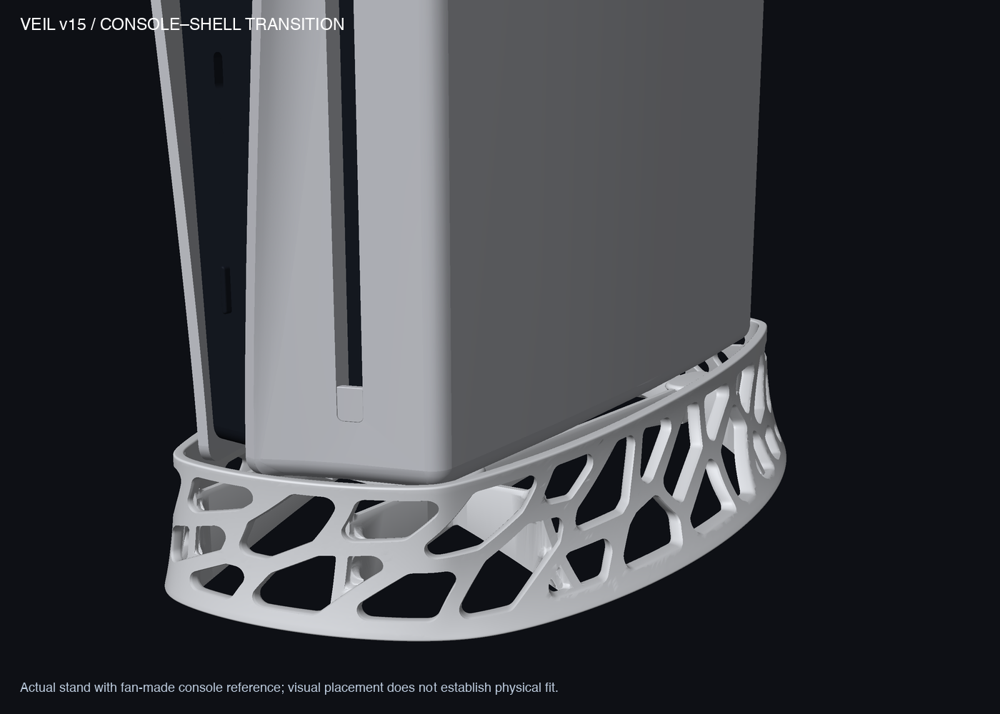
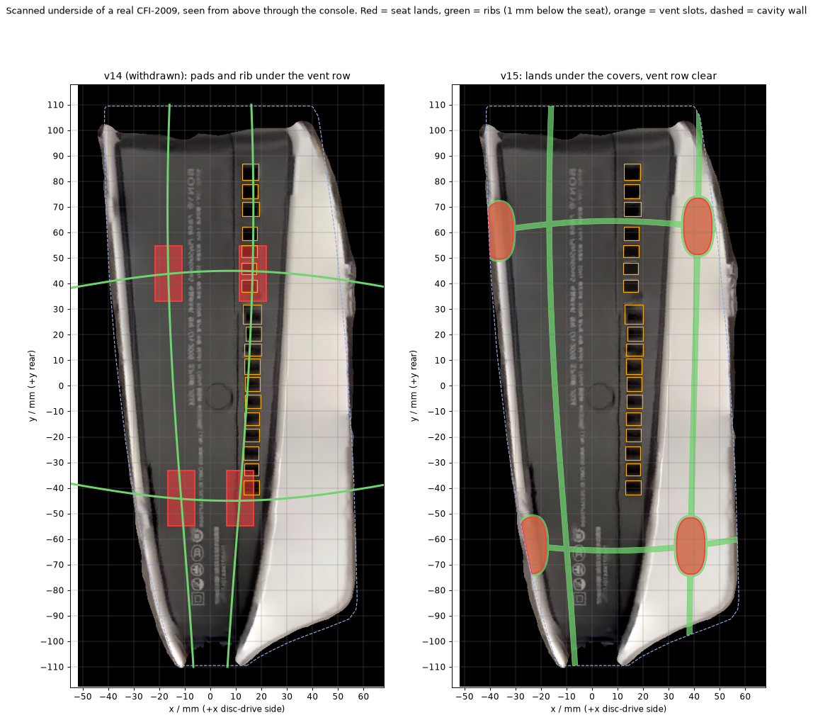
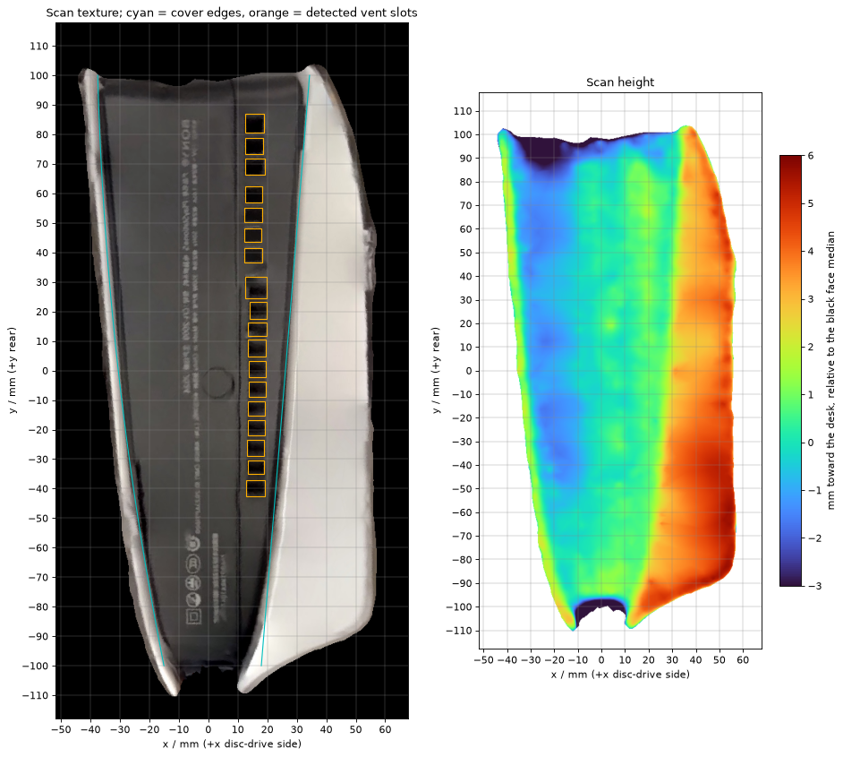
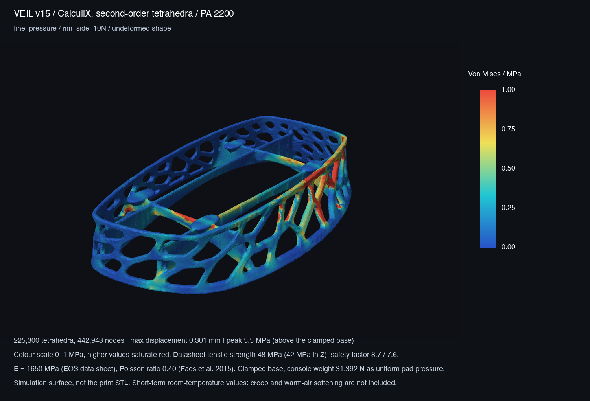
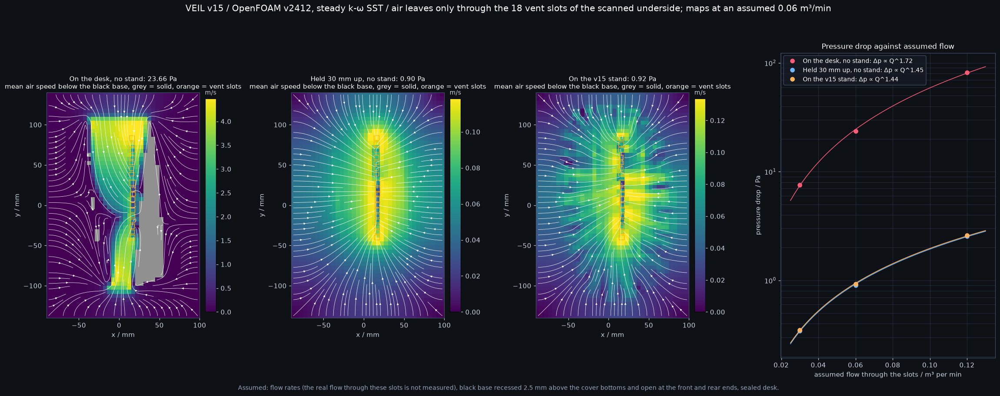

# Veil v15 — seat moved onto the real console underside

v15 keeps v14's shell, openings and wall. It changes where the console rests, because v14's seat was laid out on a wrong picture of the console's underside. The four seat pads and two of the four ribs moved; stress and airflow were redone against the measured underside. **This is a design and simulation prototype, not a qualified stand.** Nothing has been printed or fitted to a console. The print plan is in [PRINT_SERVICE.md](PRINT_SERVICE.md).



[Standalone shell](output/hero_v15.png) · [Four views](output/preview_v15_clean.png) · [12-angle turntable](output/turntable_v15.png) · [Flat-shaded side profile](output/side_profile_flat.png)

Overall size is **152.83 × 247.08 × 40.70 mm**, volume **78.14 cm³** (v14: 79.26). Seat height 30 mm, 1.5 mm nominal cavity clearance, 72 openings. The wall is 2.8 mm at the tight ends and 3.5 mm along the long sides.

| Deliverable | Purpose |
|---|---|
| [3MF](output/veil_v15_prototype.3mf) / [STL](output/veil_v15_prototype.stl) | Prototype geometry, millimetres; no printer settings |
| [Source](source/veil_v15.py), [seat layout](source/seat_layout.py) | Editable generator |
| [Fit gauge](output/GAUGE_v15_cavity_1.6mm.stl) / [print coupon](output/PRINT_TEST_v15_section.stl) | Cavity outline check; a crop with wall, openings, rib and one seat pad |

## 1. What was wrong in v14

v14's seat and both of its tests used the fan-made console model. That model's underside is a flat, symmetric black block with no openings, and its white covers end 4.4 mm *above* that block. A real CFI-2009 is different in three ways:

- The white covers end **below** the black base, by 2–3 mm in the scan. Standing on a desk, the console rests on the cover bottoms and the black base hangs clear.
- The black base has a row of **18 vent slots** on the disc-drive side.
- The black base is not symmetric. It is a wedge between the two covers, about 70 mm wide at the rear and 37 mm at the front.

v14's two disc-side pads and its disc-side rib sat directly under the vent row. Its stress model pressed on a surface the console does not touch, and its airflow model drew air through a solid face.



## 2. Measuring the real underside

Source: a phone scan (Scaniverse) of the owner's CFI-2009, standing base-up. A second, coarser scan of the same console was used only to confirm the layout by eye.

1. **Scale.** The scan is scaled so the console is 216 mm deep, its published size (358 × 96 × 216 mm, 3.2 kg, from retailer listings of the disc model). The scan's own scale read 3% larger.
2. **Position.** The lower 70 mm of the scan is fitted to the outer shape of the fan-made model by rigid point matching (`source/register_scan.py`). The remaining misfit is 1.6 mm RMS. This puts the scan in the same coordinates as the stand: +x is the disc-drive side, +y is the rear.
3. **Features.** `source/underside_from_scan.py` reads the cover edges and the vent slots from the scan's colour texture (4 pixels per mm) and the step between covers and black base from its geometry.

| Feature | Measured |
|---|---|
| Vent slots | 18, each about 6 × 5 mm, in one row at x = 12 to 20 mm, from y = −43 to +87 mm. Open area about 590 mm² as drawn |
| Disc-drive cover, inner edge | x = 26.1 + 0.082·y mm (18 mm at the front, 34 mm at the rear) |
| Other cover, inner edge of its rim | x = −13 mm at the front, running to −37 mm at the rear; the rim is about 5 mm wide |
| Covers below the black base | Disc-drive cover 2.0 to 3.7 mm; other rim 1.0 to 3.8 mm |
| Round feature in the black base | About 10 mm across, near (2, −5) mm; not used |



Limits of this measurement:

- **Plan positions are good to about 2–3 mm.** That is the sum of the fit error and the scale uncertainty.
- **The step height is not reliable.** The scan mesh has 2 mm triangles, which smooths a 2–3 mm step, and the narrow rim more than the wide cover. The real step is probably at the upper end of the measured range. It needs a ruler.
- **One console was scanned.** Other CFI-20xx revisions are not checked.

Data: [underside.json](../../references/console-scan/underside.json), [registration.json](../../references/console-scan/registration.json), `underside_grid.npz`. The raw scans are not in the repository because they show the room.

## 3. The new seat

The console rests on the stand the way it rests on a desk: on the bottoms of its covers. Four flat pads, all at 30 mm, sit under the covers. Nothing touches the black base.

| | v14 | v15 |
|---|---|---|
| What the pads sit under | The fan-made model's flat block; on real hardware, two of them under the vent row | Two under the disc-drive cover, two under the rim of the other cover |
| Pad centres (x, y) mm | (±16.5, 44), (±11.5, −44) | (−36.5, 60.6), (41.4, 62.4), (−23.5, −62.5), (38.6, −62.7) |
| Flat land per pad | 21.6 × 10.6 mm | Same shape, 206 mm² each; the two rim-side pads are clipped where they merge into the wall |
| Stand material under a vent slot | Two pads and a rib | None at any height |
| Stand material under the vent row, between slots | — | One 2.8 mm cross rib, 1 mm below the seat, in the 4 mm gap between two slots |
| Support polygon | 33 × 88 mm | 78 × 125 mm (front edge 62 mm); the footprint centre is 32 mm inside its nearest edge |

- **Lengthwise ribs.** One runs under the disc-drive cover at x = 38 to 42 mm. The other stays under the black base at x = −9 to −19 mm, at least 3 mm below it if the step is 2 mm.
- **Cross ribs** moved from y = ±37…45 to y = ±56…65 mm. The rear one crosses the vent row in the gap between two slots; the front one passes 20 mm ahead of the first slot.
- **Pads at the wall.** The two rim-side pads overlap the wall, so they are trimmed to stay 0.8 mm inside its outer face and act as ledges carried by the wall as well as by a rib.
- Rib crests stay 1 mm below the seat. Crossings and rib feet are filleted as in v14.
- The wall, openings, rim and base are unchanged from v14 (0 inflections in the rim outline, tightest radius 10.7 mm, steepest lean 43.6°; [wall_smoothness.json](analysis/wall_smoothness.json)).

What this layout assumes: **the four cover bottoms that touch the pads lie in one plane**, as they must if the console stands on a desk without rocking. Evidence: [underside_review.json](analysis/underside_review.json), from `source/review_underside.py`.

## 4. Stress (Gmsh + CalculiX, PA 2200)

### Model

- **Material:** EOS PA 2200, linear elastic. Modulus 1,650 MPa (EOS data sheet), Poisson's ratio 0.40 (Faes et al. 2015). Tensile strength 48 MPa in the build plane and 42 MPa along the build direction.
- **Mesh:** MMG remeshes the simulation surface (a 0.45 mm voxel model of the print STL), Gmsh fills it with second-order tetrahedra. Three densities: 106,000, 225,000 and 306,000 elements. The mesh is refined at the pads, the rib crossings and the disc-side wall struts.
- **Support:** the base ring is clamped.
- **Load:** console 3.2 kg (31.4 N).
  - *Pressure:* an even pressure on the parts of the four pads that lie under a cover in the scan (about 475 mm²; the rim-side pads are loaded on roughly half their land).
  - *Contact:* a rigid flat plate rests on the pads without friction and carries the weight at the footprint centre, so each pad's share follows from equilibrium.
- **Cases:** weight; uneven weight (pressure: all of it on the two disc-side pads; contact: weight point moved 10 mm toward the disc side); weight plus a 10 N sideways push spread over the upper wall on the disc side.

### Results

| Case | Loading | Deflection, coarse / fine / extra-fine | Highest stress above the base | Where |
|---|---|---:|---:|---|
| Weight | pressure | 0.120 / 0.116 / 0.111 mm | 2.68 / 3.02 / 2.71 MPa | Wall strut behind the rear disc-side pad |
| Weight | contact | 0.051 / 0.050 mm | 3.74 / 2.88 MPa | Edge of a pad land |
| Uneven weight | pressure | 0.189 / 0.172 / 0.169 mm | 3.42 / 3.86 / 3.65 MPa | Same strut; front disc-side pad root |
| Uneven weight | contact | 0.067 / 0.064 mm | 4.01 / 3.18 MPa | Edge of a pad land |
| Weight + 10 N side push | pressure | 0.322 / 0.301 / 0.292 mm | 6.51 / 5.52 / 6.53 MPa | Wall strut under the push |
| Weight + 10 N side push | contact | 0.321 / 0.302 mm | 6.31 / 5.38 MPa | Wall strut under the push |



- **Safety factor.** The highest stress in any run is 6.5 MPa, under the side push: 7.3 against the build-plane strength and 6.4 against the build-direction strength. Under plain weight the factors are 16 and 14 (fine mesh, pressure).
- **Bulk stress.** 99.9% of the material is at or below 1.1 MPa under weight and 2.0 MPa under the side push. These values move by less than 4% between the two finer meshes.
- **Pad shares** (fine mesh, contact, plain weight): 6.4, 9.4, 8.2 and 7.4 N on the rear rim-side, rear disc-side, front rim-side and front disc-side pads, which is 20%, 30%, 26% and 24%. With the weight moved 10 mm to the disc side they become 13%, 37%, 21% and 29%. All four pads stay loaded in every case.
- **Compared with v14** (weight 4.7 MPa, uneven 6.1 MPa, side push 6.6 MPa on its finest mesh): the weight cases are lower because the pads now stand next to the wall instead of at mid-span of the ribs. The side-push case is the same, because it loads the wall and not the seat.
- **Not converged:** the strut peak under the side push does not settle as the mesh is refined (6.5, 5.5, 6.5 MPa), and the contact peak at a pad edge depends on the mesh (3.7 then 2.9 MPa). Treat both as ranges.
- **Deflection differs between the two loadings** (0.12 against 0.05 mm under weight). The pressure load is applied on the cover side of each pad only, which bends the rim-side pads; the rigid plate keeps the four lands level. The real console is between the two.

Heatmaps: `output/ccx_*`. Data: `ccx/*/results.json`, `ccx/mesh_*.json`, `ccx/surf_*.json`.

### Still missing

- Slow sag under constant weight (creep) and softening in warm air.
- Tipping and sliding of the whole stand on the desk.
- The stress in the console's own cover edges; the two rim-side pads carry 6 to 8 N each on a strip about 5 mm wide.
- The in-house first-order stress screen used up to v14 was dropped; it is in the `v14` tag.

## 5. Airflow (OpenFOAM)

Question: how much harder is it for air to reach the underside slots with the stand than without it?

### Set-up

- OpenFOAM v2412, `simpleFoam`, steady incompressible air at 20 °C, k-ω SST.
- The console is its footprint, extruded upward from the cover bottoms. The black base is recessed 2.5 mm above them and is open at the front and rear ends of the console.
- **Air leaves only through the 18 scanned vent slots.** Each slot is a short duct through the console to the outlet. The four sides of the domain are open to still air. The desk is a wall.
- Three arrangements:
  - **Desk:** the console standing straight on the desk. Air must enter the 2.5 mm gap under the black base from its two ends.
  - **Lifted:** the console held 30 mm above the desk with nothing under it.
  - **Stand:** the console on v15.
- **The flow rates are assumptions.** Nobody has measured how much air this console draws through these slots. The three flows give 0.8, 1.7 and 3.4 m/s through the slots.
- Pressure drop is the room's total pressure minus the total pressure at the top of the slot ducts. It includes the loss of the slots themselves, which is the same in all three arrangements.

### Results

| Assumed flow | Speed in the slots | Desk | Lifted 30 mm | On the stand | Stand adds |
|---:|---:|---:|---:|---:|---:|
| 0.03 m³/min | 0.9 m/s | 7.6 Pa | 0.34 Pa | 0.35 Pa | 0.006 Pa (1.6%) |
| 0.06 m³/min | 1.7 m/s | 23.7 Pa | 0.90 Pa | 0.92 Pa | 0.024 Pa (2.6%) |
| 0.12 m³/min | 3.4 m/s | 82.0 Pa | 2.56 Pa | 2.59 Pa | 0.031 Pa (1.2%) |



- **The stand costs almost nothing in this set-up.** It adds 1 to 3% to the pressure drop of the lifted console. Nearly all of that drop is the slots themselves.
- **Standing on the desk costs 22 to 32 times more** than standing on the stand, because all the air has to pass through the thin gap under the black base.
- **Where the air comes from** (0.06 m³/min, stand): 70% through the two long sides, 18% from the rear and 12% from the front.

### Sensitivity at 0.06 m³/min

| Change | Pressure drop | Against the standard case |
|---|---:|---:|
| Desk, black base recessed 2.0 mm instead of 2.5 | 38.57 Pa | +63% |
| Desk, recessed 3.5 mm | 11.75 Pa | -50% |
| Stand, recessed 2.0 mm | 0.95 Pa | +3% |
| Stand, recessed 3.5 mm | 0.91 Pa | -1% |
| Stand, base cell 1.8 mm instead of 2.5 | 0.81 Pa | -12% |
| Lifted, base cell 1.8 mm | 0.79 Pa | -12% |
| Desk, base cell 1.8 mm | 25.33 Pa | +7% |

- The desk result depends strongly on the gap under the black base, which is the least certain measurement in the scan. The stand result does not.
- **Mesh.** A finer mesh lowers the stand and lifted results by the same 12%, so the difference between them holds (0.021 Pa, 2.7%). The absolute values are therefore good to about 10–15%. All 16 meshes pass `checkMesh`.
- Flow imbalance between inlet and outlet is below 0.0290% in every case.

### Limits

- This is a comparison of three arrangements under assumed flows, not a cooling prediction. The console has other, larger air inlets that are not modelled; how much of its air comes through the underside slots is unknown.
- The model is isothermal. Warm air returning to the inlet is not modelled.
- The 1.5 mm gap between the console and the stand wall is only two cells wide.
- Whether the gap under the black base is really open at both ends is read from the scan texture, not measured.
- The lattice-Boltzmann screen used up to v14 was dropped; it is in the `v14` tag.

Data: [openfoam/summary.json](openfoam/summary.json); each case's `summary.json` is regenerated with the case.

## Still open

- **Step between covers and black base.** A ruler reading at the front and rear of each cover would replace the scan's 2–3 mm. The rib crests are 1 mm below the seat, so any visible step is enough for clearance; the airflow comparison with the desk depends on it.
- **Do the four cover bottoms lie in one plane?** Stand the console on a flat table and check that it does not rock.
- **Rear grille.** Teardown photographs show a grille low on the back of the Slim. The rim stands 8–11 mm above the cover bottoms; whether it overlaps that grille has not been checked on hardware.
- **Fan flow** through the underside slots is unmeasured.
- No slicing, printing, fit, load, creep or thermal test has been done.

## Reproduce

Set-up, from the repository root. The solvers run in containers defined in [docker/compose.yaml](docker/compose.yaml).

```sh
git lfs install && git lfs pull
python3.13 -m venv .venv-cad
.venv-cad/bin/pip install -r designs/v15/source/requirements-fea.txt -r designs/v15/source/requirements-solvers.txt
docker compose -f designs/v15/docker/compose.yaml build ccx              # CalculiX 2.20
docker compose -f designs/v15/docker/compose.yaml pull openfoam          # OpenFOAM v2412
```

Then:

```sh
P=.venv-cad/bin/python
# Underside from a scan (the raw scan is not in the repository; convert it to GLB, z up, metres):
$P designs/v15/source/register_scan.py scan.glb -0.16 0.16 -0.12 0.26 references/console-scan/registration.json 0.971
$P designs/v15/source/underside_from_scan.py scan.glb references/console-scan/registration.json references/console-scan

$P designs/v15/source/veil_v15.py designs/v15/output            # geometry, about 3 minutes
(cd designs/v15/source && ../../../$P review_underside.py)      # seat against the scan
$P designs/v15/source/review_geometry.py; $P designs/v15/source/review_wall.py
$P designs/v15/source/render_clean.py; $P designs/v15/source/render_turntable.py

designs/v15/source/run_stress.sh                                # all CalculiX cases, about 40 minutes
designs/v15/openfoam/run_all.sh 6 2                             # all OpenFOAM cases, about 90 minutes
```

- Git LFS carries the simulation surface, `ccx/mesh_*.msh`, `ccx/surf_*.stl` and each CalculiX case's `model.npz` and `*_fields.npz`.
- Git-ignored and regenerated on demand: CalculiX `.inp` and `.frd`, and `openfoam/cases/`.
- The fan-made console model in `references/console-model/` is still used for the console's outer shape and for the pictures.

### Known problems and decisions

- **CalculiX equation solver on one thread.** With several threads SPOOLES returned unbalanced, wrong solutions on the fine mesh. `docker/compose.yaml` sets `CCX_NPROC_EQUATION_SOLVER=1`.
- **Memory.** Three fine-mesh contact cases side by side exceeded the 16 GB Docker VM while OpenFOAM was also running; one was killed and rerun alone.
- **Contact plate height.** The simulation surface puts the pad lands 0.2–0.3 mm above 30 mm. The rigid plate starts at the measured land level; starting it at 30 mm pushed surface nodes through thin elements.
- **Contact surfaces.** Only faces between 29.2 and 30.3 mm near a pad are contact surfaces. Without the upper limit the wall rim next to the rim-side pads was picked up.
- **Gmsh** cannot mesh the print STL directly, so the mesh starts from the voxel simulation surface, as in v14.
- **Scan registration at fixed scale.** With a free scale the fit shrank the scan by 6% to hide its noise.
