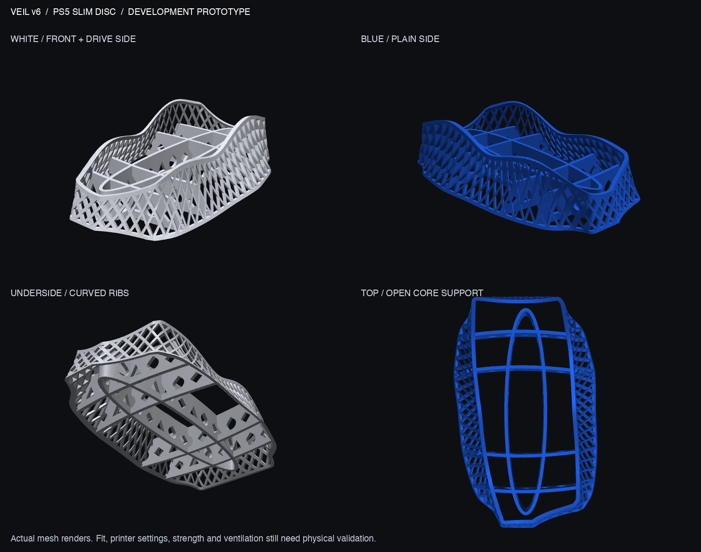

# Veil v6 — PS5 Slim Disc development prototype

An editable continuation of v5: smoother surface construction, an oval undercroft with swept cross-ribs, and PlayStation-inspired geometry. **For design review, quoting and prototype tests; not a qualified load-bearing accessory.**



## What changed

- Continuous lofted surfaces replace v5's stacked 0.5 mm slabs. The final mesh uses 0.05 mm simplification tolerance; this does not remove the printer's own layer lines.
- A softer asymmetric saddle reaches about 63.35 mm. Front/rear centerlines dip to about 29.3 mm, just below the 30 mm seat. The surrounding shoulders remain higher.
- X crossings and rotated-square openings form the outer lattice. The underside uses an oval ribbon, swept cross-ribs, triangles, rotated squares and circle-derived teardrops. The teardrop roofs deliberately compromise the circle for FDM printing.
- The opaque inner liner is removed. Nominal lattice width/depth are 2.6/2.4 mm; under-console ribs are 3.2 mm. The perimeter has a continuous 2.4 mm-high base band.
- The reference-derived cavity retains 1.5 mm nominal clearance. The original fit gauge remains unchanged; a regenerated v6 gauge and a small print-test section are also included.

## Deliverables

| File | Purpose |
|---|---|
| `output/veil_v6_prototype.3mf` | Preferred millimeter mesh exchange; geometry only, **no machine settings** |
| `output/veil_v6_prototype.stl` | Matching mesh; import in millimeters at 100% |
| `output/GAUGE_v6_cavity_1.6mm.stl` | Low-material outline check, not a supporting stand |
| `output/PRINT_TEST_v6_section.stl` | 29.6 × 32 × 48.5 mm real lattice/rim section, upright and grounded |
| `output/preview_v6.png` | White/blue, top and underside views of the actual mesh |
| `output/reference_assembly.png` | Fan-made console placed in the stand; visual context only |
| `output/layer_screen.png` | Locations needing slicer overhang review |
| `VALIDATION.md` | Results, assumptions and remaining tests |
| `PRINT_SERVICE.md` | English/Chinese vendor brief |
| `source/` | Parametric Python source and inherited outline; no proprietary CAD required |

Overall mesh: **151.30 × 244.18 × 63.35 mm**, one connected watertight body. Solid geometric volume: **107.82 cm³**, approximately **134 g at an assumed 1.24 g/cm³ density**. That is not a slicer-derived material/price estimate and excludes supports/brim.

## Reproduce

Python 3.13 was used. From the project root:

```sh
python3.13 -m venv .venv-cad
.venv-cad/bin/pip install -r designs/v6/source/requirements.txt
.venv-cad/bin/python designs/v6/source/veil_v6.py designs/v6/output
.venv-cad/bin/python designs/v6/source/validate.py
.venv-cad/bin/python designs/v6/source/render_preview.py
.venv-cad/bin/python designs/v6/source/render_context.py
.venv-cad/bin/python designs/v6/source/render_sections.py
```

Render scripts use a macOS font, with a default-font fallback on other platforms. The context render additionally needs the supplied console GLB at its original project location. Geometry generation and validation do not alter imported files. `splat.py` and `outline.json` are derived from the user-supplied v5 source. No STEP/B-rep file is claimed; editable geometry is the Python generator.

## Next physical step

Have the service print the gauge and the test section first, using the proposed production process. Confirm the gauge around the lower console without forcing it. It cannot establish rear cable clearance, retention, core contact or ventilation. The full stand needs an unloaded fit inspection and a separate load/stability check before it supports a console. See the vendor brief and validation report for acceptance questions.
