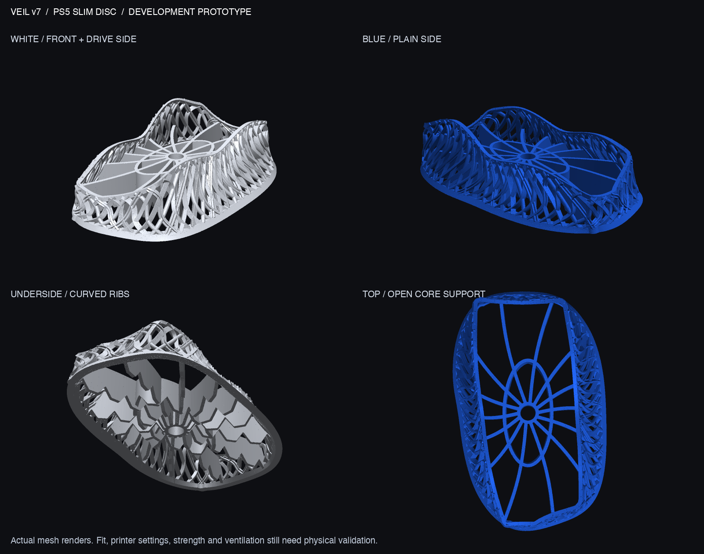

# Veil v7 — flowing mesh and structural screening

A bird-nest-inspired PS5 Slim Disc prototype: asymmetric sweeping strands, a smooth saddle silhouette, and a star-like underside. Each strand has a **triangle, circle, X or square cross-section**. Those symbols describe the cut end of the strand, not the shape of the lattice openings.

**Historical development prototype, not the selected final design or a qualified console support.** The user subsequently rejected v9 as well; v10 is now in development with revised exterior and underside requirements. v7 is preserved as the wider structural baseline. Following the user's desk-space feedback, [compact v8](../v8/README.md) has been generated separately; v7's results must not be transferred to a smaller design without checking it.



The exported reinforced stand measures **161.65 × 251.76 × 65.22 mm**, with a solid geometric volume of **193.17 cm³**. Its footprint is about 10.35 mm wider and 7.58 mm longer than v6. The console seat remains 30 mm above the desk, and the inherited reference cavity retains 1.5 mm nominal clearance. These are design dimensions, not measurements of the user's console.

## Design and validation

Two interwoven families of 51 curved strands create the open exterior. The underside uses 14 curved radial ribs, a hollow central hub and an oval tie ring. Structure takes priority there; symbol-shaped holes are not the design requirement. A local, smoothly blended 30% strand enlargement near the drive-side rear junction is the simulation-driven reinforcement trial retained in this version. The unreinforced CAD remains in `baseline/`.

The main STL, 3MF, gauge and test section reopen successfully; the STL is one connected watertight body with consistent winding and 187,292 triangles. Mesh simplification leaves tiny reference-envelope intersections: 0.00012 mm³ against the inherited console plan and 0.0030 mm³ against the nominal clearance envelope. This is not a complete 3D fit test. Export cleanup fills only sub-mm³ enclosed microvoids and removes microscopic fragments under explicit source thresholds; the manufacturing geometry is not the regularized simulation mesh.

A geometric screen at 0.2 mm intervals found **21 new nonoverlapping section islands** over 325 sections. Local overhangs and strand intersections require process-specific slicing; support-free printing is not established. See [the vendor brief](PRINT_SERVICE.md) and [machine-readable geometry checks](output/validation.json).

Actual solid finite-element stress and displacement fields are available in the [3D viewer](output/stress_heatmap_3d.html). Read [the structural analysis](STRUCTURAL_ANALYSIS.md) alongside it: assumed material, fixed feet, simplified contact and regularized geometry make this an exploratory screen. Fine-profile notch stresses, printed strength, creep and real console contact are not qualified. No result proves an absence of weak points.

Ventilation and hardware constraints remain those documented in [v6 validation](../v6/VALIDATION.md#ventilation-evidence-and-limits). Sony requires unobstructed vents and surrounding clearance. The exact bottom intake/exhaust region on the user's unit remains unresolved; there is no CFD, temperature result or claimed cooling improvement. A stress heatmap is not a thermal simulation.

## Files

| File | Purpose |
|---|---|
| [3MF](output/veil_v7_prototype.3mf) / [STL](output/veil_v7_prototype.stl) | Reinforced development mesh; millimeters, no printer settings |
| [Fit gauge](output/GAUGE_v7_cavity_1.6mm.stl) | Low-material outline check; cannot support a console |
| [Print-test section](output/PRINT_TEST_v7_section.stl) | 45.41 × 32 × 49.20 mm local process coupon; not a strength specimen |
| [Strand profiles](output/strand_profiles.png) | Actual triangle/circle/X/square sections |
| [3D stress viewer](output/stress_heatmap_3d.html) | Rotate solved geometry and compare load cases/iterations |
| [Structural analysis](STRUCTURAL_ANALYSIS.md) | Assumptions, convergence, reinforcement trial and limitations |
| [Print-service brief](PRINT_SERVICE.md) | English and Chinese instructions for quotation and prototype review |
| `source/` | Editable parametric CAD, rendering and analysis scripts |
| `baseline/` | Preserved unreinforced v7 CAD for comparison |

The separate `undercroft_star.stl` is an analysis component, **not** the complete stand to order. The print-test section samples only a local region; it does not contain every printing challenge.

## Reproduce geometry

Use the project's Python 3.13 `.venv-cad` environment. CAD dependencies include NumPy, SciPy, manifold3d, trimesh, shapely, Pillow and lxml. From the project root:

```sh
VEIL_SUPPORT=star VEIL_REINFORCE=1 .venv-cad/bin/python designs/v7/source/veil_v7.py designs/v7/output
.venv-cad/bin/python designs/v7/source/validate.py
.venv-cad/bin/python designs/v7/source/render_preview.py
.venv-cad/bin/python designs/v7/source/profile_figure.py
```

`star` and reinforcement enabled are the current source defaults. Set `VEIL_REINFORCE=0` and write to a separate directory to reproduce the unreinforced geometry. The optional honeycomb source mode is exploratory and is not the selected production candidate. See the structural report for the distinct FE preparation and solver steps. Editable source is Python; no STEP/B-rep export is claimed.

All four original uploads and all ten extracted v5 files, including its fit gauge, remain unchanged: [hash verification](../../docs/originals_check_v7.json). Fit, material, load/stability and thermal testing remain physical prototype tasks.
