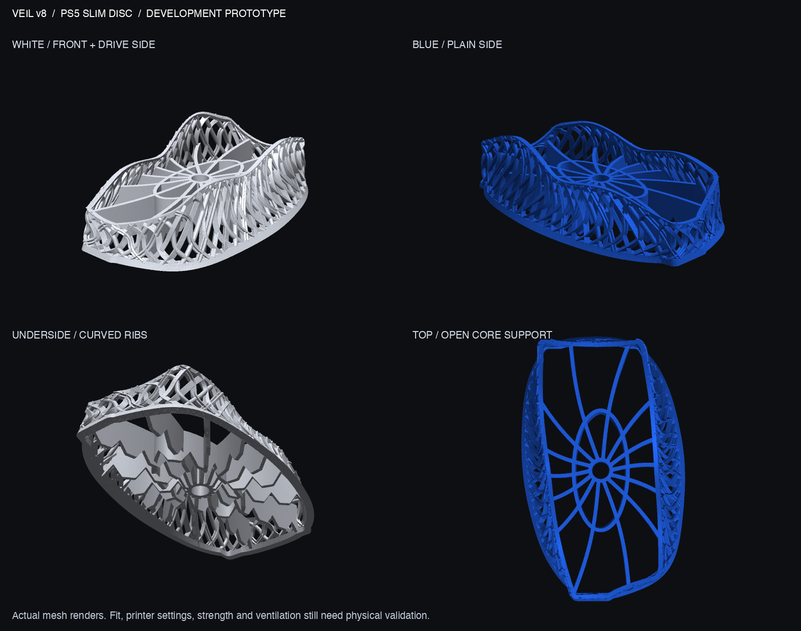
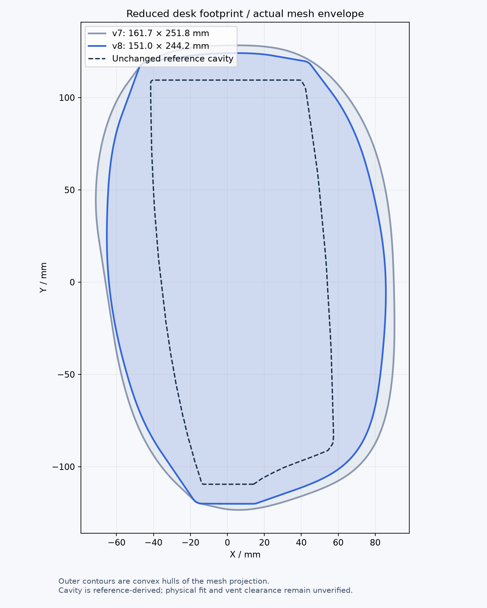

# Veil v8 — compact bird-nest candidate

The exterior sweep is pulled inward to reduce desk footprint while retaining the flowing asymmetric mesh, triangle/circle/X/square **strand cross-sections**, star-like underside and inherited console cavity. **Historical development candidate, not the selected final design or a qualified console support.** The user subsequently rejected v9 as well; v10 is now in development with revised exterior and underside requirements.



| Geometry | Wider v7 | Compact v8 |
|---|---:|---:|
| Overall width | 161.65 mm | **151.02 mm** |
| Overall length | 251.76 mm | **244.23 mm** |
| Overall height | 65.22 mm | 65.22 mm |
| Geometric volume | 193.17 cm³ | 185.89 cm³ |
| Projected convex-hull area | 337.20 cm² | 307.45 cm² |

The compact candidate is 10.64 mm narrower and 7.53 mm shorter, with about **8.8% less projected convex-hull area**. That area is a geometric envelope, not the actual desk-contact area. It returns approximately to v6's footprint without globally scaling the console cavity. The 30 mm seat height, 1.5 mm nominal reference clearance and rim landmarks remain unchanged.



## Files and checks

- [3MF](output/veil_v8_prototype.3mf) and [STL](output/veil_v8_prototype.stl): compact reinforced candidate, millimeters; no printer settings.
- [Fit gauge](output/GAUGE_v8_cavity_1.6mm.stl) and [local print coupon](output/PRINT_TEST_v8_section.stl): print these first. The gauge is byte-identical to v7's; the compact coupon is about 40.79 × 32 × 49.20 mm, 6.70 cm³.
- [Strand sections](output/strand_profiles.png), [reference assembly](output/reference_assembly.png), [geometry checks](output/validation.json) and [footprint data](output/footprint_comparison.json).
- [English/Chinese vendor brief](PRINT_SERVICE.md).
- [Wider-v7 structural analysis](../v7/STRUCTURAL_ANALYSIS.md): the prior numerical baseline; **its results do not qualify compact v8**. v8 FE work stopped at meshing; no solved v8 stress result is claimed.

STL/3MF and test pieces pass the geometry checks. The main STL is one connected watertight body with 175,834 triangles. The extruded inherited console-plan intersection is 0 mm³; the nominal clearance envelope has a tiny 0.00377 mm³ intersection after export. These checks do not establish real-console fit or true minimum clearance.

The 0.2 mm geometric layer screen found **42 new nonoverlapping section islands**, versus 21 in v7. Compactness has therefore not established easier FDM printing. The vendor must review thin members, intersecting profiles, supports and their removal in a real slicer. Largest flagged regions include the base and heights around 10.5, 25.1, 43.3 and 53.3 mm. This is geometry screening, not generated toolpaths.

The conditional rigid-body tipping estimate spans approximately 4.98–6.15 N for a push at 388 mm above the desk across nine assumed center-of-mass positions. It assumes a 3.2 kg console rigidly coupled without slip, an assumed material density, flat desk and known contact hull. The loose cavity has no positive screw retention; the console may move independently. These figures are not a stability qualification or a comparison with Sony's stand. They must not be confused with a 10 N local upper-shell load applied to fixed feet in an elastic simulation.

Hardware contact, plugs/cables, disc access, vent clearance, physical strength and thermal behavior remain unverified. [Sony ventilation evidence and its limits](../v6/VALIDATION.md#ventilation-evidence-and-limits) still apply. The fan-made reference assembly render is visual context, not proof of fit.

## Reproduce geometry

From the project root using the Python 3.13 `.venv-cad` environment:

```sh
VEIL_SUPPORT=star VEIL_REINFORCE=1 .venv-cad/bin/python designs/v8/source/veil_v8.py designs/v8/output
.venv-cad/bin/python designs/v8/source/validate.py
.venv-cad/bin/python designs/v8/source/render_preview.py
.venv-cad/bin/python designs/v8/source/render_context.py
.venv-cad/bin/python designs/v8/source/profile_figure.py
```

The changed flare parameters are 21.8 mm side and 4.8 mm end, versus v7's 30 and 9 mm. Editable geometry is the Python generator, not a STEP/B-rep file. The wider v7 and all imported originals remain preserved; the latest original-file [hash check](../../docs/originals_check_v7.json) verifies four uploads and ten extracted v5 files.
